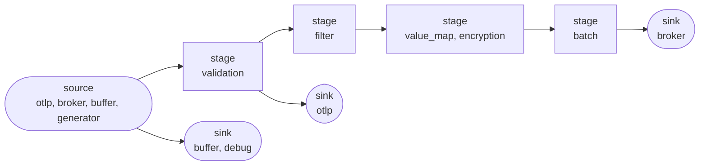
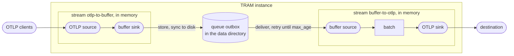
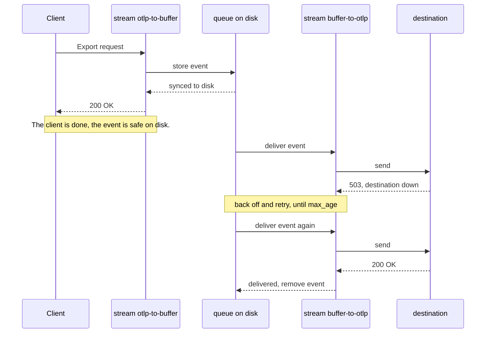

# Components Documentation

This document provides detailed documentation for all implemented sources, stages, and sinks in TRAM.

## 🗺️ How Components Fit Together

A stream is a tree of components: exactly one **source** at the root, which receives or produces events, any number of **stages**, which filter, check, change or merge them, and **sinks** as the leaves, which deliver them. Every component names the one it receives from in `from`, so a stream can branch: each branch gets the same events and handles them on its own. See [Streams](README.md#core-concepts) for how a stream runs.



## 📋 All Components

| Component | Kind | Drivers | Signals | Holds events back | State on disk | Performance |
|-----------|------|---------|---------|-------------------|---------------|-------------|
| [`otlp`](#otlp-source) | source | – | all | – | – | ✓ |
| [`broker`](#broker-source) | source | `nats`, `kafka`, `amqp` | one per source (`signal`) | – | – | ✓ NATS |
| [`buffer`](#buffer-source) | source | `sqlite` | all | – | reads the queue | – |
| [`generator`](#generator-source) | source | – | empty events | – | – | – |
| [`validation`](#validation-stage) | stage | `cel` | per signal | – | – | ✓ |
| [`filter`](#filter-stage) | stage | `cel` | per signal | – | – | ✓ |
| [`value_map`](#value-map-stage) | stage | – | all | – | – | ✓ |
| [`encryption`](#encryption-stage) | stage | `local`, `stackitkms` | logs | – | – | ✓ `local` |
| [`decryption`](#decryption-stage) | stage | `local`, `stackitkms` | logs | – | – | ✓ `local` |
| [`batch`](#batch-stage) | stage | – | all | up to `timeout` | – | ✓ |
| [`delay`](#delay-stage) | stage | – | all | for `delay` | – | – |
| [`noop`](#no-op-stage) | stage | – | all | – | – | ✓ |
| [`otlp`](#otlp-sink) | sink | – | all | – | – | – |
| [`broker`](#broker-sink) | sink | `nats`, `kafka`, `amqp` | per signal (`destination`) | – | – | ✓ NATS |
| [`buffer`](#buffer-sink) | sink | `sqlite` | all | – | writes the queue | – |
| [`debug`](#debug-sink) | sink | – | all | – | – | – |

- **Holds events back:** the caller waits while the stage holds an event, which counts toward the [Hold Times](#hold-times) a stream may add up.
- **State on disk:** everything else works in memory; only a buffer keeps events on the instance's disk, between two streams. See [Buffers](#buffers).
- **Performance:** the component's page shows its measured costs; see [Benchmarks](BENCHMARK.md) for complete streams.

## 🧭 Which Component for What

| To … | Use |
|------|-----|
| receive OTLP from SDKs, agents or a Collector | [`otlp` source](#otlp-source), with `header_attributes` for what a proxy in front knows, e.g. the tenant |
| read from or write to NATS, Kafka or AMQP | [`broker` source](#broker-source) and [`broker` sink](#broker-sink) |
| ride out an outage of a destination | a [`buffer` sink](#buffer-sink) in one stream and a [`buffer` source](#buffer-source) in another; see [Buffers](#buffers) |
| accept or refuse whole requests | [`validation`](#validation-stage), with `on_mismatch: reject` before a batch |
| keep only some records | [`filter`](#filter-stage) |
| set an attribute from a table, e.g. tenant → router | [`value_map`](#value-map-stage) |
| keep values secret on their way | [`encryption`](#encryption-stage) before the sinks, [`decryption`](#decryption-stage) where they may be read |
| send fewer, larger requests or messages | [`batch`](#batch-stage) before the sink |
| route each record to its own destination | the `destination` expressions of the [`broker` sink](#broker-sink), or `url_expression` of the [`otlp` sink](#otlp-sink) |
| see what a stream does | [`debug` sink](#debug-sink), or `tram test` with test cases; see [Testing a Stream](README.md#testing-a-stream) |
| try out how a stream is wired | [`generator` source](#generator-source) and [`noop` stage](#no-op-stage) |

## 🔌 Drivers

Some components are a concept with exchangeable technologies: the broker source and sink with NATS, Kafka or AMQP, the buffer with SQLite, encryption and decryption with a local key or a KMS, filter and validation with CEL. Such a component names its technology in `driver` and holds the driver's options under the driver's name; the fields beside them are the component's own and apply to every driver:

```yaml
type: broker
spec:
  driver: nats                  # the technology
  nats:                         # the options of that driver
    url: nats://nats:4222
  destination:                  # the component's own fields, the same for every driver
    logs: "'logs.' + resource.attributes.get_attr('service.name')"
```

Switching the technology changes `driver` and its options; what the component does stays the same. Options of a driver other than the one `driver` names are refused, so a spec cannot name one driver and configure another.

---

## 📡 Sources

Sources are the entry points of a pipeline that produce or receive data events.

### Available Sources

| Type | Description |
|------|-------------|
| [`broker`](#broker-source) | Receives OTLP data from a message broker through a driver (NATS JetStream, Kafka, AMQP 1.0) |
| [`buffer`](#buffer-source) | Reads a queue on the instance's disk that a Buffer Sink writes, through a driver (SQLite), and delivers it with retries; see [Buffers](#buffers) |
| [`generator`](#generator-source) | Emits empty events at a fixed interval, for testing pipelines |
| [`otlp`](#otlp-source) | Receives OpenTelemetry Protocol (OTLP) data over HTTP and gRPC, optionally with request headers as resource attributes |

### Generator Source

Emits an empty event at a fixed interval, for testing how a stream is wired. Stages that count or inspect records, like `batch` or `filter`, ignore the events.

**Type:** `generator`

**Configuration:**

| Field | Type | Required | Default | Description |
|-------|------|----------|---------|-------------|
| `interval` | string | Yes | - | Time interval between events (e.g., `"5s"`, `"1m"`) |

**Example:**

```json
{
  "name": "event-generator",
  "type": "generator",
  "spec": {
    "interval": "5s"
  }
}
```

### OTLP Source

Receives OpenTelemetry Protocol data over HTTP (OTLP/HTTP), over gRPC (OTLP/gRPC), or both. Set `http_port`, `grpc_port` or both; a stream that uses both gets the data of either protocol.

**Type:** `otlp`

**Configuration:**

| Field | Type | Required | Default | Description |
|-------|------|----------|---------|-------------|
| `http_port` | int | One of the two | - | Port for OTLP/HTTP, on all network interfaces; usually `4318` |
| `grpc_port` | int | One of the two | - | Port for OTLP/gRPC, on all network interfaces; usually `4317`. Must differ from `http_port` |
| `delivery_timeout` | string | No | `"8s"` | Maximum time to pass a request on to the stages and sinks, as a Go duration. A request that takes longer is cancelled and answered with `503`, which clients retry |
| `retry_after` | string | No | `"5s"` | How long clients should wait before retrying a `503`, as a Go duration. Sent as the `Retry-After` header in whole seconds, rounded up |
| `header_attributes` | object | No | - | Request headers to copy into resource attributes, as header name → attribute key, e.g. `{"X-Tram-Router": "tram.router.id"}`. Over gRPC, the metadata of the same name. See below |

**Example:**

```json
{
  "name": "otlp-receiver",
  "type": "otlp",
  "spec": {
    "http_port": 4318,
    "grpc_port": 4317
  }
}
```

**Header attributes:** a proxy in front of TRAM, e.g. one ingress per tenant, can tell TRAM something about a request that the client must not choose, such as the tenant or the router its data belongs to, by setting a header. `header_attributes` makes that part of the data: the source sets the attribute on every resource of the request, where stages and sinks read it, e.g. a broker sink's destination `'router.' + resource.attributes.get_attr('tram.router.id') + '.logs'`, and where it survives a broker between streams, since broker messages carry no headers.

```json
{
  "name": "customer-in",
  "type": "otlp",
  "spec": {
    "http_port": 4318,
    "grpc_port": 4317,
    "header_attributes": { "X-Tram-Router": "tram.router.id" }
  }
}
```

The header decides the attribute alone: a value the client put into the attribute itself is replaced, and removed when the header is missing or empty. A header with several values is refused (`422`, `InvalidArgument` over gRPC), since it is unclear which one the proxy meant, e.g. when it appended its value to a header the client sent instead of replacing it. The header is only as trustworthy as the way to TRAM: let only the proxy reach the source's port, e.g. with a network policy, and have it replace the header rather than add to it.

**Responses** (OTLP/HTTP status, OTLP/gRPC code):

| HTTP | gRPC | When |
|------|------|------|
| `200` | `OK` | Empty response message in the request's encoding, once all sinks have accepted the data |
| `422` | `InvalidArgument` | Body cannot be read or parsed, contains a duplicate key, or holds data rejected by a stage or sink (e.g. `validation` with `on_mismatch: reject`) |
| `413` | `ResourceExhausted` | Body larger than 20 MiB, also after decompression |
| `415` | - | Other content types or encodings |
| `503` | `Unavailable` | Passing the data on failed or took longer than `delivery_timeout`; sent with a `Retry-After` header over HTTP and a `RetryInfo` detail over gRPC, both from `retry_after`. The only status OTLP clients retry — the only answer the request itself did not cause |

??? note "Behavior"

    - Accepts `POST` requests on `/v1/logs`, `/v1/metrics` and `/v1/traces` with a protobuf (`application/x-protobuf`) or JSON (`application/json`) body. Requests without a content type are read as protobuf
    - Bodies may be compressed with `Content-Encoding: gzip`
    - Each request becomes one event and is passed on as a whole
    - A request in which a key appears twice in the same key-value list is refused with `422`: the attributes of a resource, scope, log record, span, span event, span link, data point or exemplar, a metric's metadata, and key-value lists nested in values or log bodies. OTLP requires unique keys; with a key twice, a stage could check one value while a sink routes by the other. The same key in different lists, e.g. on the resource and on a record, is allowed
    - A rejection is answered with `422` wherever it comes from, including a sink whose destination refuses the data permanently, e.g. an [OTLP Sink](#otlp-sink) whose destination answers `401`, `403` or `404` because of its own configuration. The client then drops data it did not cause to be refused
    - The default `delivery_timeout` is below the 10s that OpenTelemetry SDK exporters wait by default, so they get the `503` before they give up. `batch` and `delay` stages have to leave time for it, see [Hold Times](#hold-times). Raise it for pipelines that take longer, e.g. with a `delay` stage or slow sinks, and for clients that wait longer, like the OpenTelemetry Collector (30s by default). A batch that is already being sent when the timeout expires is still awaited, since it holds data of other requests too
    - A request may take up to 1 minute to send, which leaves time for large bodies on slow connections
    - The ports are opened when the stream is created, so a port that is already in use fails the stream creation. An update that keeps the source keeps its ports open
    - Over gRPC, it serves the OTLP `LogsService`, `MetricsService` and `TraceService`, without TLS. Messages may be compressed with gzip; the 20 MiB limit applies to the decompressed message
    - Partial success is not used: a request is accepted or refused as a whole, over both protocols
    - Header names in `header_attributes` are matched regardless of case. Two headers may not set the same attribute

#### Performance

Each request costs a fixed amount on top of its records, so small requests are expensive per record: let senders batch, e.g. with the batch processor of an OpenTelemetry SDK or Collector, rather than sending every record on its own.

<!-- BEGIN benchreport:component:otlp-source -->
| Component | Per record | Allocs per record | Records/s | Spread |
|---|---|---|---|---|
| OTLP source: decoding a request | 1.48 µs | 34.3 | 677 k | ±10% ⚠️ |

| Component | Per event | Allocs per event | Spread |
|---|---|---|---|
| OTLP source: request with one record | 6.47 µs | 85 | ±23% ⚠️ |

Measured on 13th Gen Intel(R) Core(TM) i7-13700K, commit `d060ee2`, 2026-11-18; compare with other components under [Where the Time Goes](BENCHMARK.md#where-the-time-goes).
<!-- END benchreport:component:otlp-source -->

### Broker Source

Receives OTLP data from a message broker chosen by `driver` (driver options under `nats:`, `kafka:`, `amqp:`). Every message is one serialized OTLP `LogsData`, `MetricsData` or `TracesData` — the plain body the [Broker Sink](#broker-sink) writes, so any producer can feed the source. The broker is set up outside TRAM; the source creates or updates only its consumer.

**Type:** `broker`

**Configuration:**

| Field | Type | Required | Default | Description |
|-------|------|----------|---------|-------------|
| `driver` | string | Yes | - | The broker: `nats` (NATS JetStream), `kafka` (Apache Kafka and compatible brokers) or `amqp` (AMQP 1.0, e.g. ActiveMQ Artemis, RabbitMQ 4, Solace, Azure Service Bus) |
| `signal` | string | Yes | - | What every message holds: `logs`, `metrics` or `traces`. Messages name no signal themselves, so a source reads one signal; read several with one source each |
| `workers` | int | No | `1` | Number of messages processed concurrently (1-10000) |
| `partition` | object | No | - | Reads the partition of a key from data a Broker Sink spread over partitions: `count` (1-1024) as in the sink, and the required `key`. `{partition}` in the driver's options is replaced by the key's partition |
| `nats` | object | With `driver: nats` | - | Options of the NATS driver, see below |
| `kafka` | object | With `driver: kafka` | - | Options of the Kafka driver, see below |
| `amqp` | object | With `driver: amqp` | - | Options of the AMQP driver, see below |

**NATS driver options (`nats`):**

| Field | Type | Required | Default | Description |
|-------|------|----------|---------|-------------|
| `url` | string | Yes | - | NATS server URL, e.g. `nats://localhost:4222` |
| `subject` | string | Yes | - | Subject filter of the consumer; wildcards like `logs.*` are allowed |
| `stream` | string | No | - | Stream that holds `subject`. Without it, the stream is looked up by `subject` when the source starts |
| `durable` | string | No | - | Name of a durable consumer. Without it, a temporary consumer is created whenever the source is created |

**Kafka driver options (`kafka`):**

| Field | Type | Required | Default | Description |
|-------|------|----------|---------|-------------|
| `brokers` | array[string] | Yes | - | Seed brokers, `host:port` |
| `topic` | string | Yes | - | Topic to read, from all its partitions |
| `group` | string | Yes | - | Consumer group. Sources that share it split the partitions; the group's committed offsets are where a source continues |
| `tls` | object | No | - | Connect with TLS and the system's certificate authorities; `insecure_skip_verify: true` skips the verification, for tests only |
| `sasl` | object | No | - | Authenticate: `mechanism` (`plain`, `scram-sha-256` or `scram-sha-512`), `username`, `password`. In a `Stream` resource, take them from a secret with `valueFrom.secretKeyRef` |

**AMQP 1.0 driver options (`amqp`):**

| Field | Type | Required | Default | Description |
|-------|------|----------|---------|-------------|
| `url` | string | Yes | - | Broker URL, `amqp://host:5672` or `amqps://host:5671` |
| `address` | string | Yes | - | Address to read, e.g. a queue. Its form depends on the broker: a queue name on ActiveMQ Artemis and Solace, `/queues/<name>` on RabbitMQ 4 |
| `username`, `password` | string | No | - | Authenticate with SASL PLAIN; without them the connection uses SASL ANONYMOUS. In a `Stream` resource, take them from a secret with `valueFrom.secretKeyRef` |
| `insecure_skip_verify` | bool | No | `false` | Skip the verification of the broker's certificate with `amqps`, for tests only |

??? note "Solace with the AMQP driver"

    Solace PubSub+ brokers speak AMQP 1.0, so they are used through `driver: amqp`; TRAM has no Solace driver of its own, because Solace's Go API needs cgo and TRAM's image is a static binary.

    - Enable the AMQP service of the message VPN. Solace gives each message VPN its own AMQP port, plain text and TLS (`amqps://`); use that port in `url`
    - `username` and `password` are a client username of the message VPN; it needs permission to publish to the destinations of a sink and to consume from the queue of a source
    - A source's `address` is the name of a queue, set up outside TRAM with consume permission for the client username. A retried message is returned as a failed delivery, so the queue's maximum redelivery count and its dead message queue apply. A sink's destinations are queue names, or topics in Solace's AMQP address syntax
    - This combination is not covered by TRAM's automated tests: the Solace container needs a user ID that rootless Podman with the default subordinate ID range cannot map. The AMQP driver is tested against ActiveMQ Artemis; verify against your Solace version before relying on it

**Example:**

```json
{
  "name": "audit-in",
  "type": "broker",
  "spec": {
    "driver": "nats",
    "signal": "logs",
    "workers": 64,
    "nats": {
      "url": "nats://localhost:4222",
      "subject": "audit.logs",
      "durable": "audit"
    }
  }
}
```

??? note "Behavior"

    - A message that is not valid OTLP data of `signal` is rejected and not redelivered. Protobuf does not name its type, so data of another signal may decode without error; keep one signal per subject
    - Each message becomes one event. A message is acknowledged once all sinks have accepted it. If passing it on fails, it is redelivered after 5 seconds; data rejected by a stage or sink is rejected for good
    - Delivery is at-least-once, and messages are not processed in order unless `workers` is 1
    - Up to `workers` messages are processed at the same time. The driver buffers only as many messages as there are workers, so no message waits long for a worker while its acknowledgement deadline runs
    - A `batch` stage after the source holds up to `workers` messages, since every message waits for its batch to be delivered before it is acknowledged. To let batches fill up to `max_records` before their `timeout`, set `workers` to at least `max_records` divided by the records per message
    - Stopping or updating the source interrupts waiting for new messages right away; messages being processed are still delivered and acknowledged
    - With `partition`, the source computes the partition of `key` like the [Broker Sink](#broker-partitioning) and replaces `{partition}` in every option of the driver. Without `partition`, the options must not contain it; with it, at least one must
    - **NATS:** the consumer starts at the beginning of the stream. A durable consumer continues where it stopped. Its `MaxAckPending` is twice `workers`, at least 1,000, the JetStream default; the limit applies across all TRAM replicas that share a durable consumer
    - **NATS:** with large messages and many workers, NATS can have a lot of data to send to the source at once. If that exceeds what the server buffers for one connection (`max_pending`, 64 MB by default), the server disconnects the source as a slow consumer, and the messages it had sent come again after their acknowledgement deadline. Lower `workers`, or raise `max_pending` above `workers` × message size
    - **NATS:** a lost connection is retried every 2 seconds, with up to 1 second of jitter, for as long as the source runs. A stream that does not exist when the source starts fails the TRAM stream, which is retried
    - **Kafka:** offsets are committed per partition, every second and when the source stops, and only up to the first message that is not done yet, so messages finished out of order are never skipped by a restart. A message that is retried comes again after the delay from the same source; its offset stays uncommitted until it is done, so a restart reads it again. A rejected message counts as done; TRAM writes no dead-letter topic
    - **Kafka:** a topic that does not exist when the source starts fails the TRAM stream, which is retried. A group rebalance hands partitions to other sources; messages of those partitions that were not done yet are read again by their new owner
    - **AMQP:** the source has credit for twice `workers` messages. AMQP 1.0 has no delayed redelivery: a retried message is held for the delay and then returned as a failed delivery, which counts towards the broker's limit of attempts before it dead-letters the message; it keeps its credit while held. A rejected message is settled as rejected, and the broker's policy decides what happens to it, usually a dead-letter address
    - **AMQP:** a lost connection is opened again with growing delays, up to 5 seconds; messages not settled on the lost connection are delivered again by the broker. An address the broker does not have fails the TRAM stream when it starts, unless the broker creates addresses on demand

#### Performance

Workers process messages in parallel; more `workers` lower the cost per record until the broker or the stages below become the limit.

<!-- BEGIN benchreport:component:broker-source -->
| Component | Per record | Allocs per record | Records/s | Spread |
|---|---|---|---|---|
| Broker source (NATS), 1 worker | 1.61 µs | 34.2 | 621 k | ±5% |
| Broker source (NATS), 8 workers | 270.0 ns | 34.2 | 3.70 M | ±1% |

Measured on 13th Gen Intel(R) Core(TM) i7-13700K, commit `d060ee2`, 2026-11-18; compare with other components under [Where the Time Goes](BENCHMARK.md#where-the-time-goes).
<!-- END benchreport:component:broker-source -->

---

### Buffer Source

Reads the queue a [Buffer Sink](#buffer-sink) of the same instance writes and delivers its events to the stages and sinks of its stream. A delivery that fails is retried with exponential backoff until the queue's `max_age`; see [Buffers](#buffers) for how the two streams work together.

**Type:** `buffer`

**Configuration:**

| Field | Type | Required | Default | Description |
|-------|------|----------|---------|-------------|
| `driver` | string | Yes | - | The storage of the queue: `sqlite` |
| `sqlite` | object | With `driver: sqlite` | - | Options of the SQLite driver; it has none yet, so `{}` |
| `queue` | string | Yes | - | The queue to read: letters, digits and `. _ -`, starting with a letter or digit. The same name as in the Buffer Sink |
| `workers` | int | No | `1` | Number of events delivered at once (1-10000) |
| `retry_initial` | string | No | `"1s"` | Delay before the first retry of a failed delivery, as a Go duration; it doubles with every failure |
| `retry_max` | string | No | `"5m"` | Longest delay between retries |
| `signal` | string | No | - | Only for drivers whose queues do not record the signal; SQLite does, so a source reads logs, metrics and traces alike |

**Example:**

```json
{
  "name": "outbox",
  "type": "buffer",
  "spec": {
    "driver": "sqlite",
    "sqlite": {},
    "queue": "outbox",
    "workers": 4,
    "retry_initial": "1s",
    "retry_max": "5m"
  }
}
```

??? note "Behavior"

    - An event that a node below rejects for good, e.g. a `422` of the destination, is removed at once; an event older than the queue's `max_age` is removed after its next failed delivery, or by the cleanup every minute. Both are logged as warnings
    - Delivery is at-least-once: an event is delivered again if the instance stops during its delivery. The order of deliveries is not guaranteed
    - Retries keep their schedule across restarts. An event whose delivery was interrupted by a restart is delivered again right away
    - Like the Broker Source, it waits for nothing: its stages and sinks get each event as soon as it is due, and their hold times do not count against any timeout of the source
    - Without a data directory (`tram server --data-dir`), the stream fails to build

## 🔧 Stages

Stages process, transform, or filter data between sources and sinks.

### Available Stages

| Type | Description |
|------|-------------|
| [`batch`](#batch-stage) | Merges concurrently arriving events into larger batches |
| [`decryption`](#decryption-stage) | Decrypts log record bodies and selected attributes encrypted by the encryption stage |
| [`delay`](#delay-stage) | Holds every event back for a fixed duration |
| [`encryption`](#encryption-stage) | Encrypts log record bodies and selected attributes before the sinks |
| [`filter`](#filter-stage) | Keeps only the records that match the rules of its driver, e.g. CEL |
| [`noop`](#no-op-stage) | Pass-through stage that does no processing (useful for testing) |
| [`validation`](#validation-stage) | Accepts, drops or rejects whole events by the rules of its driver, e.g. CEL |
| [`value_map`](#value-map-stage) | Copies an attribute value to another attribute by looking it up in a table |

### Filter Stage

Keeps only the records that match the rules of the driver chosen by `driver`, decided per log record, metric data point and span. The driver's options are under the driver's name, e.g. `cel:`. To accept or reject whole events instead, use the [Validation Stage](#validation-stage).

**Type:** `filter`

**Configuration:**

| Field | Type | Required | Default | Description |
|-------|------|----------|---------|-------------|
| `driver` | string | Yes | - | The technology of the rules: `cel` (Common Expression Language) |
| `cel` | object | With `driver: cel` | - | Options of the CEL driver, see below |

**CEL driver options:**

| Field | Type | Required | Default | Description |
|-------|------|----------|---------|-------------|
| `logs` | string | One of `logs`, `metrics`, `traces` | - | CEL expression evaluated per log record. Must return a boolean |
| `metrics` | string | One of `logs`, `metrics`, `traces` | - | CEL expression evaluated per metric data point. Must return a boolean |
| `traces` | string | One of `logs`, `metrics`, `traces` | - | CEL expression evaluated per span. Must return a boolean |

Signal types without an expression are passed on unfiltered. Use `"false"` to remove a signal type completely.

**CEL Expression Context:**

| Expression | Variables |
|------------|-----------|
| `logs` | `resource` (Resource), `scope` (InstrumentationScope), `record` (LogRecord) |
| `metrics` | `resource`, `scope`, `metric` (Metric), `datapoint` (the data point; its type depends on the metric type) |
| `traces` | `resource`, `scope`, `span` (Span) |

`resource` and `scope` are empty messages when the payload has none, so their fields can be accessed without checks. Field names follow the OTLP protobuf definitions, e.g. `record.severity_text`, `span.name`, `datapoint.attributes`.

**Example:** split logs by customer into two branches:

```json
"stages": [
  {
    "name": "customer-a",
    "type": "filter",
    "from": "otlp-in",
    "spec": {
      "driver": "cel",
      "cel": {
        "logs": "record.attributes.exists(a, a.key == 'customer' && a.value.string_value == 'A')"
      }
    }
  },
  {
    "name": "other-customers",
    "type": "filter",
    "from": "otlp-in",
    "spec": {
      "driver": "cel",
      "cel": {
        "logs": "!record.attributes.exists(a, a.key == 'customer' && a.value.string_value == 'A')"
      }
    }
  }
]
```

**Additional Examples** (the `cel` options):

Keep only ERROR logs:
```json
{ "logs": "record.severity_text == 'ERROR'" }
```

Keep only the data points of one metric:
```json
{ "metrics": "metric.name == 'http.server.request.duration'" }
```

Keep only spans of one service:
```json
{ "traces": "resource.attributes.exists(a, a.key == 'service.name' && a.value.string_value == 'checkout')" }
```

??? note "Behavior"

    - Kept records are passed on in their original resource and scope; nothing is copied, and containers without remaining records are removed. If no record is kept, nothing is passed on
    - When splitting into branches, write the last branch as the negation of the others, so every record ends up in exactly one branch
    - A rule that fails for a record, e.g. a CEL expression accessing a missing list index, rejects the whole event. The OTLP source answers with HTTP 422, the Broker Source rejects the message instead of redelivering it
    - Place a batch stage before the filters to merge many small requests first; each branch then receives one filtered batch

#### Performance

The expression runs once per log record, data point or span. Put filters early in a stream, so the stages and sinks below handle only what is kept.

<!-- BEGIN benchreport:component:filter -->
| Component | Per record | Allocs per record | Records/s | Spread |
|---|---|---|---|---|
| filter (CEL), keeping half of the records | 1.77 µs | 16.6 | 565 k | ±9% |
| filter (CEL), keeping all records | 920.0 ns | 8.0 | 1.09 M | ±24% ⚠️ |

Measured on 13th Gen Intel(R) Core(TM) i7-13700K, commit `d060ee2`, 2026-11-18; compare with other components under [Where the Time Goes](BENCHMARK.md#where-the-time-goes).
<!-- END benchreport:component:filter -->

### Validation Stage

Checks each incoming event as a whole — one OTLP request, one broker message, or one batch — against the rules of the driver chosen by `driver`, and passes it on, drops it, or rejects it. The driver's options are under the driver's name, e.g. `cel:`. To keep only matching records, use the [Filter Stage](#filter-stage).

**Type:** `validation`

**Configuration:**

| Field | Type | Required | Default | Description |
|-------|------|----------|---------|-------------|
| `driver` | string | Yes | - | The technology of the rules: `cel` (Common Expression Language) |
| `on_mismatch` | string | Yes | - | Action when a signal does not match its rule: `"drop"` or `"reject"` |
| `cel` | object | With `driver: cel` | - | Options of the CEL driver, see below |

**CEL driver options:**

| Field | Type | Required | Default | Description |
|-------|------|----------|---------|-------------|
| `logs` | string | No | - | CEL expression evaluated once for all logs of an event. Must return a boolean. Without it, all logs match |
| `metrics` | string | No | - | CEL expression evaluated once for all metrics of an event. Must return a boolean. Without it, all metrics match |
| `traces` | string | No | - | CEL expression evaluated once for all traces of an event. Must return a boolean. Without it, all traces match |

**CEL Expression Context:**
- Each expression receives the complete payload of its signal type: `logs` (LogsData), `metrics` (MetricsData), or `traces` (TracesData)
- An event can contain several signal types, e.g. after a batch stage. Each type present is checked with its own expression
- Use the full protobuf structure, e.g. `logs.resource_logs.all(...)`, and write the expression as a condition that every accepted delivery has to fulfil

**On Mismatch Behavior:**
- `drop` - Removes all data of the signal type that did not match. Other signal types of the event are still passed on; if nothing is left, nothing is passed on
- `reject` - Rejects the whole event with an error. The OTLP source answers with HTTP 422, the Broker Source rejects the message instead of redelivering it

**Example:** reject log deliveries in which a resource has no `service.name`:

```json
{
  "name": "require-service-name",
  "type": "validation",
  "from": "source",
  "spec": {
    "driver": "cel",
    "on_mismatch": "reject",
    "cel": {
      "logs": "logs.resource_logs.all(r, r.resource.attributes.exists(a, a.key == 'service.name'))"
    }
  }
}
```

**Additional Examples:**

Drop metric deliveries that contain a metric without a name:
```json
{
  "driver": "cel",
  "on_mismatch": "drop",
  "cel": {
    "metrics": "metrics.resource_metrics.all(r, r.scope_metrics.all(s, s.metrics.all(m, m.name != '')))"
  }
}
```

Reject trace deliveries that contain a span without a valid trace ID:
```json
{
  "driver": "cel",
  "on_mismatch": "reject",
  "cel": {
    "traces": "traces.resource_spans.all(r, r.scope_spans.all(s, s.spans.all(span, size(span.trace_id) == 16)))"
  }
}
```

Reject log deliveries that contain a record whose `tenant.id` is not a lowercase UUID. `matches` takes an RE2 regular expression and finds it anywhere in the value, so anchor it with `^` and `$`. Checking a value that a [Broker Sink](#broker-sink) puts into its NATS subjects keeps out dots, whitespace and wildcards, which would make the subject invalid or change its meaning:
```json
{
  "driver": "cel",
  "on_mismatch": "reject",
  "cel": {
    "logs": "logs.resource_logs.all(r, r.scope_logs.all(s, s.log_records.all(record, record.attributes.exists(a, a.key == 'tenant.id' && a.value.string_value.matches('^[0-9a-f]{8}-[0-9a-f]{4}-[0-9a-f]{4}-[0-9a-f]{4}-[0-9a-f]{12}$')))))"
  }
}
```

??? note "Behavior"

    - The decision applies to the whole event. An expression like `log_records.exists(record, record.severity_text == 'ERROR')` passes on a delivery with one ERROR and many INFO records in full, including the INFO records
    - A rule that fails for an event, e.g. a CEL expression accessing a missing list index, rejects the whole event regardless of `on_mismatch`. The OTLP source answers with HTTP 422, the Broker Source rejects the message instead of redelivering it
    - Place validation stages with `on_mismatch: reject` before a batch stage, so one invalid delivery does not reject the deliveries batched with it

#### Performance

An expression that only looks at resources is far cheaper than one that walks every record, since there are far fewer resources than records; prefer resource-level rules where they suffice.

<!-- BEGIN benchreport:component:validation -->
| Component | Per record | Allocs per record | Records/s | Spread |
|---|---|---|---|---|
| validation (CEL), record-level expression | 1.07 µs | 9.1 | 931 k | ±18% ⚠️ |
| validation (CEL), resource-level expression | 13.5 ns | 0.1 | 73.86 M | ±14% ⚠️ |

Measured on 13th Gen Intel(R) Core(TM) i7-13700K, commit `d060ee2`, 2026-11-18; compare with other components under [Where the Time Goes](BENCHMARK.md#where-the-time-goes).
<!-- END benchreport:component:validation -->

### Batch Stage

Merges events that arrive concurrently into one event, so downstream components handle fewer, larger batches. It batches whatever it receives; use a filter stage before it to batch only some of the data.

**Type:** `batch`

**Configuration:**

| Field | Type | Required | Default | Description |
|-------|------|----------|---------|-------------|
| `max_records` | int | No | `8192` | Flushes once the batch holds at least this many records (log records, metric data points and spans). Events are never split, so a batch can exceed it by the size of the last event |
| `max_bytes` | int | No | - | Flushes a batch before the next event would take it over this many bytes of encoded OTLP data. Without it, the size is not limited |
| `timeout` | string | No | `"200ms"` | Flushes a batch this long after its first event arrived |

**Example:**

```json
{
  "name": "batch",
  "type": "batch",
  "from": "otlp-in",
  "spec": {
    "max_records": 1000,
    "timeout": "500ms"
  }
}
```

??? note "Behavior"

    - Batching happens in memory only. Each caller waits until its batch has been delivered and receives the delivery result, so sources keep acknowledging or rejecting exactly what was delivered, and a slow downstream slows the sources down instead of growing the buffer
    - Batching only helps when events arrive concurrently, e.g. parallel OTLP requests or a Broker Source with several `workers`. A source that sends one event at a time only adds `timeout` to its latency
    - Behind an OTLP source, `timeout` has to stay below the source's `delivery_timeout` (8s by default), together with the other `batch` and `delay` stages on the way to a sink; otherwise the stream is rejected, see [Hold Times](#hold-times)
    - If a caller's context is cancelled (e.g. the OTLP client disconnects or the OTLP source's `delivery_timeout` expires) before the batch flushes, its event is withdrawn and not delivered. Once the flush has started, the event is delivered and the caller waits for the result
    - A delivery error, including a rejection by a later stage, applies to every event in the batch. Place `validation` stages with `on_mismatch: reject` before the batch, so one invalid event does not reject the others
    - `max_bytes` keeps batches below a limit downstream, e.g. the NATS server's `max_payload` (1 MB by default) or the request size a destination accepts. It counts the protobuf encoding of the data, which is what the NATS and OTLP sinks send uncompressed. An event that is larger by itself is sent alone, since events are never split, so the limit downstream can still be exceeded by single large requests. Measuring costs a pass over every event, so it is only done with `max_bytes` set
    - Events are merged by concatenating their resource entries. Resources and scopes that appear in several events are kept as separate entries, which OTLP allows
    - On shutdown, the open batch is delivered before downstream stages and sinks stop

#### Performance

Batching costs little per record and lowers the fixed costs per event of everything below it, e.g. one broker message instead of many.

<!-- BEGIN benchreport:component:batch -->
| Component | Per record | Allocs per record | Records/s | Spread |
|---|---|---|---|---|
| batch, 8 concurrent callers | 0.5 ns | 0.0 | 2.10 G | ±7% |

| Component | Per event | Allocs per event | Spread |
|---|---|---|---|
| batch, one caller | 1.65 µs | 15 | ±7% |

Measured on 13th Gen Intel(R) Core(TM) i7-13700K, commit `d060ee2`, 2026-11-18; compare with other components under [Where the Time Goes](BENCHMARK.md#where-the-time-goes).
<!-- END benchreport:component:batch -->

### Delay Stage

Holds every event back for a fixed duration; the caller waits meanwhile, concurrent events in parallel. Useful for testing and simulating slow downstream systems.

**Type:** `delay`

**Configuration:**

| Field | Type | Required | Default | Description |
|-------|------|----------|---------|-------------|
| `delay` | string | Yes | - | Duration to hold each event back (e.g., `"100ms"`, `"1s"`, `"5m"`) |

**Example:**

```json
{
  "name": "delay-stage",
  "type": "delay",
  "from": "source",
  "spec": {
    "delay": "1s"
  }
}
```

??? note "Behavior"

    - Behind an OTLP source, the delay counts toward the source's `delivery_timeout` (8s by default). A stream in which the `delay` and `batch` stages on the way to a sink add up to the `delivery_timeout` or more is rejected, see [Hold Times](#hold-times). Raise the `delivery_timeout` for longer delays

### Encryption Stage

Encrypts the body of every log record and the record attributes listed in `attributes`, so sinks send them encrypted. Attributes it does not list — e.g. the ones a sink's destination expression routes by — stay in cleartext, as do metrics and traces. The key comes from a `driver`: `local` (a raw AES-256 key, in a Kubernetes `Stream` resource via `secretKeyRef`) or `stackit-kms` (envelope encryption against the STACKIT KMS, which wraps a per-stage data key once).

**Type:** `encryption`

**Configuration:**

| Field | Type | Required | Default | Description |
|-------|------|----------|---------|-------------|
| `driver` | string | Yes | - | Key source: `local` or `stackit-kms`; its options go under a key of the same name |
| `algorithm` | string | No | `aes-256-gcm` | Payload encryption algorithm |
| `attributes` | []string | No | - | Record attributes to encrypt besides the body (string values only) |
| `marker_prefix` | string | No | `tram.encryption` | Prefix of the marker attributes set on every encrypted record (`<prefix>.algorithm`, `<prefix>.key_id`, `<prefix>.wrapped_key`); set a neutral prefix if the attribute names should not reveal the product |
| `local.key` | string | With `driver: local` | - | Base64-encoded 32-byte key; exactly one of `key`, `key_env`, `key_file` |
| `local.key_env` | string | With `driver: local` | - | Environment variable holding the base64-encoded key |
| `local.key_file` | string | With `driver: local` | - | File holding the base64-encoded key |
| `stackit-kms.project_id` | string | With `driver: stackit-kms` | - | STACKIT project UUID |
| `stackit-kms.region` | string | With `driver: stackit-kms` | - | Region of the key ring, e.g. `eu01` |
| `stackit-kms.keyring_id` | string | With `driver: stackit-kms` | - | Key ring UUID |
| `stackit-kms.key_id` | string | With `driver: stackit-kms` | - | Key UUID |
| `stackit-kms.key_version` | int | With `driver: stackit-kms` | - | Version of the key that wraps the data key |
| `stackit-kms.endpoint` | string | With `driver: stackit-kms` | `https://kms.api.<region>.stackit.cloud` | KMS API base URL |
| `stackit-kms.token` | string | With `driver: stackit-kms` | SDK default auth | Bearer token of a STACKIT service account |

**Example:**

```json
{
  "name": "encrypt",
  "type": "encryption",
  "from": "otlp",
  "spec": {
    "driver": "local",
    "local": { "key": "<base64-encoded 32-byte key>" },
    "attributes": ["user.email"]
  }
}
```

In a Kubernetes `Stream` resource, the key can come from a secret instead of the spec:

```yaml
spec:
  stages:
    - name: encrypt
      type: encryption
      from: otlp
      spec:
        driver: local
        local:
          key:
            secretKeyRef: { name: tram-encryption-key, key: key }
        attributes: ["user.email"]
```

With the `stackit-kms` driver, the stage generates a random data key once, wraps it via the KMS, and encrypts every record locally with AES-256-GCM:

```json
{
  "name": "encrypt",
  "type": "encryption",
  "from": "otlp",
  "spec": {
    "driver": "stackit-kms",
    "stackit-kms": {
      "project_id": "<project UUID>",
      "region": "eu01",
      "keyring_id": "<key ring UUID>",
      "key_id": "<key UUID>",
      "key_version": 1,
      "token": "<STACKIT service account token>"
    },
    "attributes": ["user.email"]
  }
}
```

In a Kubernetes `Stream` resource, the token can come from a secret instead of the spec:

```yaml
spec:
  stages:
    - name: encrypt
      type: encryption
      from: otlp
      spec:
        driver: stackit-kms
        stackit-kms:
          project_id: <project UUID>
          region: eu01
          keyring_id: <key ring UUID>
          key_id: <key UUID>
          key_version: 1
          token:
            secretKeyRef: { name: stackit-kms-token, key: token }
        attributes: ["user.email"]
```

??? note "Behavior"

    - Every encrypted record carries the marker attributes `<marker_prefix>.algorithm`, `<marker_prefix>.key_id` and, for KMS drivers, `<marker_prefix>.wrapped_key` (base64) — by default `tram.encryption.*`; set `marker_prefix` to rename them. They are cleartext, so consumers know how to decrypt: with `local`, the same key; with `stackit-kms`, KMS `Decrypt` on the wrapped data key, then local AES-256-GCM. The ciphertext is nonce + AES-256-GCM tag appended, base64-encoded in string fields
    - Routing is unaffected as long as routing attributes are not listed in `attributes`: the broker and OTLP sinks evaluate their destination expressions on the encrypted event, and cleartext attributes resolve to the same subjects and URLs as without the stage. A listed attribute with a non-string value, or a body that is neither string nor bytes, rejects the event (the OTLP source answers with 422)
    - The stage never modifies the incoming event; it forwards a copy, so sibling branches see the plaintext
    - The stage holds no events back and does not count toward the [Hold Times](#hold-times)
    - Metrics and traces pass through unchanged; only logs are encrypted

#### Performance

Every encrypted attribute adds work on top of the body; encrypt only the attributes that need it.

<!-- BEGIN benchreport:component:encryption -->
| Component | Per record | Allocs per record | Records/s | Spread |
|---|---|---|---|---|
| encryption, body only | n/a | n/a | n/a | |
| encryption, body and attributes | n/a | n/a | n/a | |

Measured on 13th Gen Intel(R) Core(TM) i7-13700K, commit `d060ee2`, 2026-11-18; compare with other components under [Where the Time Goes](BENCHMARK.md#where-the-time-goes).
<!-- END benchreport:component:encryption -->

### Decryption Stage

Decrypts the body of every encrypted log record and the record attributes listed in `attributes`, and removes the encryption marker attributes the [Encryption Stage](#encryption-stage) sets. Records without a marker attribute pass through unchanged, so the stage is idempotent and can sit in a branch that also receives plaintext. Metrics and traces pass through unchanged. The `driver` and key have to match the records' `tram.encryption.key_id` marker, no matter which stream or producer encrypted them: `local` (the raw AES-256 key, in a Kubernetes `Stream` resource via `secretKeyRef`) or `stackit-kms` (the STACKIT KMS key that wrapped the per-record data key, which the stage unwraps).

**Type:** `decryption`

**Configuration:**

| Field | Type | Required | Default | Description |
|-------|------|----------|---------|-------------|
| `driver` | string | Yes | - | Key source: `local` or `stackit-kms`; its options go under a key of the same name |
| `algorithm` | string | No | `aes-256-gcm` | Payload encryption algorithm of the records; must match the records' `tram.encryption.algorithm` |
| `attributes` | []string | No | - | Record attributes to decrypt besides the body; list the same ones the encryption stage encrypted |
| `marker_prefix` | string | No | `tram.encryption` | Prefix of the marker attributes on encrypted records; has to match the prefix the records were encrypted with |
| `local.key` | string | With `driver: local` | - | Base64-encoded 32-byte key; exactly one of `key`, `key_env`, `key_file` |
| `local.key_env` | string | With `driver: local` | - | Environment variable holding the base64-encoded key |
| `local.key_file` | string | With `driver: local` | - | File holding the base64-encoded key |
| `stackit-kms.project_id` | string | With `driver: stackit-kms` | - | STACKIT project UUID |
| `stackit-kms.region` | string | With `driver: stackit-kms` | - | Region of the key ring, e.g. `eu01` |
| `stackit-kms.keyring_id` | string | With `driver: stackit-kms` | - | Key ring UUID |
| `stackit-kms.key_id` | string | With `driver: stackit-kms` | - | Key UUID |
| `stackit-kms.key_version` | int | With `driver: stackit-kms` | - | Version of the key that unwraps the data key |
| `stackit-kms.endpoint` | string | With `driver: stackit-kms` | `https://kms.api.<region>.stackit.cloud` | KMS API base URL |
| `stackit-kms.token` | string | With `driver: stackit-kms` | SDK default auth | Bearer token of a STACKIT service account |

**Example:**

```json
{
  "name": "decrypt",
  "type": "decryption",
  "from": "encrypt",
  "spec": {
    "driver": "local",
    "local": { "key": "<base64-encoded 32-byte key>" },
    "attributes": ["user.email"]
  }
}
```

In a Kubernetes `Stream` resource, the key can come from a secret instead of the spec:

```yaml
spec:
  stages:
    - name: decrypt
      type: decryption
      from: encrypt
      spec:
        driver: local
        local:
          key:
            secretKeyRef: { name: tram-encryption-key, key: key }
        attributes: ["user.email"]
```

With the `stackit-kms` driver, the stage unwraps the wrapped data key of each record via the KMS (cached in memory) and decrypts locally. Point it at the KMS key named in the records' `tram.encryption.key_id` marker — the encrypted records may well come from a different stream:

```json
{
  "name": "decrypt",
  "type": "decryption",
  "from": "encrypt",
  "spec": {
    "driver": "stackit-kms",
    "stackit-kms": {
      "project_id": "<project UUID>",
      "region": "eu01",
      "keyring_id": "<key ring UUID>",
      "key_id": "<key UUID>",
      "key_version": 1,
      "token": "<STACKIT service account token>"
    },
    "attributes": ["user.email"]
  }
}
```

In a Kubernetes `Stream` resource, the token can come from a secret instead of the spec:

```yaml
spec:
  stages:
    - name: decrypt
      type: decryption
      from: encrypt
      spec:
        driver: stackit-kms
        stackit-kms:
          project_id: <project UUID>
          region: eu01
          keyring_id: <key ring UUID>
          key_id: <key UUID>
          key_version: 1
          token:
            secretKeyRef: { name: stackit-kms-token, key: token }
        attributes: ["user.email"]
```

??? note "Behavior"

    - A record is recognized as encrypted by its `<marker_prefix>.algorithm` attribute (default `tram.encryption.algorithm`). After decryption the stage removes the marker attributes `<marker_prefix>.algorithm`, `<marker_prefix>.key_id` and `<marker_prefix>.wrapped_key`, so downstream stages and sinks see plaintext again and routing on decrypted attributes works
    - Records without the marker attribute pass through unchanged, as do metrics and traces; only logs are decrypted
    - A record whose `tram.encryption.algorithm` differs from the stage's `algorithm`, or whose `tram.encryption.key_id` differs from the driver's key (e.g. after a key rotation), rejects the event (the OTLP source answers with 422). A listed attribute with a non-string value, or a body that is neither string nor bytes, rejects the event as well
    - With `stackit-kms`, the wrapped data key of each record is unwrapped via KMS `Decrypt` and cached in memory, so repeated records do not call the KMS again
    - The stage never modifies the incoming event; it forwards a copy, so sibling branches see the ciphertext
    - The stage holds no events back and does not count toward the [Hold Times](#hold-times)

#### Performance

Every decrypted attribute adds work on top of the body; decrypt only what the destination needs.

<!-- BEGIN benchreport:component:decryption -->
| Component | Per record | Allocs per record | Records/s | Spread |
|---|---|---|---|---|
| decryption, body only | n/a | n/a | n/a | |
| decryption, body and attributes | n/a | n/a | n/a | |

Measured on 13th Gen Intel(R) Core(TM) i7-13700K, commit `d060ee2`, 2026-11-18; compare with other components under [Where the Time Goes](BENCHMARK.md#where-the-time-goes).
<!-- END benchreport:component:decryption -->

### No-op Stage

A pass-through stage that performs no processing — for testing, debugging, or as a placeholder.

**Type:** `noop`

**Configuration:** None required.

**Example:**

```json
{
  "name": "passthrough",
  "type": "noop",
  "from": "source"
}
```

#### Performance

The baseline cost of a stage: what passing an event through one more stage costs without any work.

<!-- BEGIN benchreport:component:noop -->
| Component | Per record | Allocs per record | Records/s | Spread |
|---|---|---|---|---|
| noop stage | 1.1 ns | 0.0 | 947.87 M | ±8% |

| Component | Per event | Allocs per event | Spread |
|---|---|---|---|
| Each additional noop stage | 469.6 ns | 7 | ±5% |

Measured on 13th Gen Intel(R) Core(TM) i7-13700K, commit `d060ee2`, 2026-11-18; compare with other components under [Where the Time Goes](BENCHMARK.md#where-the-time-goes).
<!-- END benchreport:component:noop -->

### Value Map Stage

Looks up a source attribute in a table for every record and sets a target attribute to the mapped value, or to `default` on a miss (missing attribute or no table entry). Every record is passed on; nothing is filtered, dropped or held back.

**Type:** `value_map`

**Configuration:**

| Field | Type | Required | Default | Description |
|-------|------|----------|---------|-------------|
| `source_attr` | string | Yes | - | Attribute whose value is looked up |
| `target_attr` | string | Yes | - | Attribute set to the result of the lookup. An existing attribute of that name is replaced |
| `default` | string | Yes | - | Value set when the source attribute is missing or its value has no table entry |
| `level` | string | No | `"record"` | Level the source attribute is read from: `record` (the record's own attributes) or `resource` (the attributes of the record's resource) |
| `table` | object | One of `table`, `table_ref` | - | Embedded lookup table, source value to target value. In a Kubernetes `Stream` resource, the table can come from config maps selected by label, which keeps large tables out of the resource; see [Config Maps](internal/adapters/k8scrd/README.md#config-maps) |
| `table_ref` | string | One of `table`, `table_ref` | - | Path to a JSON file that holds the lookup table as an object of string values, e.g. `{"value-a": "target-a"}`. Read once when the stage is created; an unreadable file or invalid JSON is rejected. Exactly one of `table` and `table_ref` has to be set |

The target attribute is always set on the record itself, whatever `level` the source attribute is read from. A source value that is not a string cannot have a table entry and receives the default value.

**Example:** translate a `team` attribute into a `team.id` attribute:

```json
{
  "name": "team-ids",
  "type": "value_map",
  "from": "otlp-in",
  "spec": {
    "source_attr": "team",
    "target_attr": "team.id",
    "default": "unassigned",
    "table": {
      "team-0": "cart",
      "team-1": "checkout"
    }
  }
}
```

**Metrics:** besides the node metrics of its stream, the stage records its lookup outcomes, with the `stream`, the `node` of the stage and the `signal` as labels:

| Metric | Type | Labels | Description |
|--------|------|--------|-------------|
| `tram_stage_value_map_mapped_total` | Counter | `stream`, `node`, `signal` | Records whose source value the table maps, which received the mapped value |
| `tram_stage_value_map_lookup_missing_attr_total` | Counter | `stream`, `node`, `signal` | Records without the source attribute, which received the default value |
| `tram_stage_value_map_lookup_no_entry_total` | Counter | `stream`, `node`, `signal` | Records whose source value has no table entry, which received the default value |

The node metrics framework counts records and durations only, not lookup outcomes, which is why the stage adds its own counters, created from the meter provider its factory passes. They are labeled like the node metrics, so every stream and stage has a series of its own.

??? note "Behavior"

    - A lookup miss is a defined state, not an error: the record is still passed on, with the target attribute set to `default`
    - Every record is annotated, so the stage always passes on a copy of the event: the containers it annotates (records of each signal) are rebuilt, resources, scopes and metric metadata are shared
    - The table is fixed while the stream runs. To change it, update the stream with a changed spec, through the API, the config sync or a `Stream` resource, or change the config maps a `Stream` resource selects its table from; the usual stream update applies: an update with an identical spec changes nothing, an update with just a changed spec replaces the stage without touching the source
    - The stage holds no events back and does not count toward the [Hold Times](#hold-times)

#### Performance

Mapping a resource attribute runs once per resource instead of once per record, so it is cheaper where the source attribute lives on the resource.

<!-- BEGIN benchreport:component:value-map -->
| Component | Per record | Allocs per record | Records/s | Spread |
|---|---|---|---|---|
| value_map, mapping a record attribute | n/a | n/a | n/a | |
| value_map, mapping a resource attribute | n/a | n/a | n/a | |

Measured on 13th Gen Intel(R) Core(TM) i7-13700K, commit `d060ee2`, 2026-11-18; compare with other components under [Where the Time Goes](BENCHMARK.md#where-the-time-goes).
<!-- END benchreport:component:value-map -->

---

## 📤 Sinks

Sinks are the terminal points of a pipeline that consume or export data.

### Available Sinks

| Type | Description |
|------|-------------|
| [`broker`](#broker-sink) | Sends OTLP data to a message broker through a driver (NATS JetStream, Kafka, AMQP 1.0), with the destination of each record computed by CEL |
| [`buffer`](#buffer-sink) | Stores OTLP data durably in a queue on the instance's disk through a driver (SQLite), for a Buffer Source to deliver; see [Buffers](#buffers) |
| [`debug`](#debug-sink) | Writes events to the log (stderr) for debugging and development |
| [`otlp`](#otlp-sink) | Sends OTLP-encoded events via HTTP to an OpenTelemetry endpoint |

### Debug Sink

Writes every event to the log on stderr as a `Debug event` record with the attributes `path` (the path through the stream, e.g. `in -> filter -> out`), `records` (number of log records, data points and spans) and `event` (the full OTLP data). For development, testing and debugging.

**Type:** `debug`

**Configuration:** None required.

**Example:**

```json
{
  "name": "console-output",
  "type": "debug",
  "from": "source"
}
```

### OTLP Sink

Sends OpenTelemetry Protocol data via HTTP to an OTLP-compatible endpoint. Sends logs to `/v1/logs`, metrics to `/v1/metrics`, and traces to `/v1/traces` with a protobuf-encoded body.

**Type:** `otlp`

**Configuration:**

| Field | Type | Required | Default | Description |
|-------|------|----------|---------|-------------|
| `url` | string | Without `url_expression` | - | OTLP HTTP endpoint URL (e.g., `"http://localhost:4318"`) |
| `url_expression` | object | No | - | Sends each entry to the URL a CEL expression returns, see [Routing by URL](#routing-by-url) |
| `headers` | object | No | - | HTTP headers to send with each request |
| `timeout` | string | No | `"10s"` | HTTP request timeout as a Go duration (e.g., `"5s"`, `"30s"`) |
| `insecure` | boolean | No | `false` | Allow connections to servers with invalid TLS certificates |

**Example:**

```json
{
  "name": "otlp-sink",
  "type": "otlp",
  "from": "source",
  "spec": {
    "url": "http://telemetry-collector:4318"
  }
}
```

**Example with authentication and custom timeout:**

```json
{
  "name": "secure-otlp-sink",
  "type": "otlp",
  "from": "filter-stage",
  "spec": {
    "url": "https://telemetry-collector:4318",
    "timeout": "30s",
    "headers": {
      "Authorization": "Bearer your-api-key-here"
    }
  }
}
```

**Example with invalid certificate acceptance (for testing):**

```json
{
  "name": "dev-otlp-sink",
  "type": "otlp",
  "from": "source",
  "spec": {
    "url": "https://localhost:4318",
    "insecure": true
  }
}
```

??? note "Behavior"

    - Each signal type of an event is sent as a separate HTTP request to its endpoint. An event can hold several signal types, e.g. after a batch stage; if one request fails, the source retries the whole event, so the others may be sent twice
    - Uses protobuf encoding (`application/x-protobuf` content type) as required by OTLP/HTTP
    - The sink handles URL construction properly, so both `"http://host:4318"` and `"http://host:4318/"` work correctly
    - Non-2xx answers fail the delivery. Client errors that refuse the data itself (4xx except 408 and 429) reject the event, so the OTLP source answers with 422 and the Broker Source rejects the message. Other errors, including 408, 429 and 5xx, can be retried by the source: the OTLP source answers with 503, the Broker Source has the message redelivered
    - Proxy settings are taken from the `HTTPS_PROXY`, `HTTP_PROXY` and `NO_PROXY` environment variables
    - Connection pooling is used for better performance with multiple requests
    - Timeout applies to the entire request lifecycle, including connection establishment and reading the response
    - The requests of an event are sent at the same time, at most 16 at once. If one fails in a way that may go away, e.g. with 503, the event fails retriably even if another destination rejected its data, so the source retries all of it. Only if every failed request was rejected is the event rejected

#### Routing by URL

With `url_expression`, the sink sends each log record, metric data point and span to the URL its expression returns, e.g. to a tenant's own endpoint. It groups the entries by URL and sends one request per URL and signal type.

| Field | Type | Required | Default | Description |
|-------|------|----------|---------|-------------|
| `logs` | string | One of `logs`, `metrics`, `traces` | - | CEL expression returning the URL of a log record |
| `metrics` | string | One of `logs`, `metrics`, `traces` | - | CEL expression returning the URL of a metric data point |
| `traces` | string | One of `logs`, `metrics`, `traces` | - | CEL expression returning the URL of a span |

- The expressions have the same variables and `get_attr` function as the destination expressions of the [Broker Sink](#broker-sink), e.g. `record`, `resource` and `datapoint`. Metrics are split per data point the same way
- A URL is the base URL like `url`; the sink appends `/v1/logs`, `/v1/metrics` or `/v1/traces`. It must be `http` or `https` and have a host. An expression that fails, does not return a string, or returns another URL rejects the event. `get_attr` returns `""` for a missing attribute, which is not a valid URL
- Signals without an expression are sent to `url`. Without `url`, they are not sent
- `headers`, `timeout` and `insecure` apply to every destination
- The data decides where it is sent. Make sure only trusted values can reach the expression, e.g. by deriving the URL from a tenant ID that a `validation` stage checks, rather than taking a URL from an attribute

**Example with an endpoint per tenant:**

```json
{
  "name": "tenant-otlp",
  "type": "otlp",
  "from": "validator",
  "spec": {
    "url_expression": {
      "logs": "'https://' + record.attributes.get_attr('tenant.id') + '.otlp.example.com'"
    }
  }
}
```

### Broker Sink

Sends OTLP data to a message broker chosen by `driver` (driver options under `nats:`, `kafka:`, `amqp:`). A CEL expression per signal computes each record's destination; the records of one signal and destination become one message. The broker is set up outside TRAM: the sink creates no streams, topics or queues.

**Type:** `broker`

**Configuration:**

| Field | Type | Required | Default | Description |
|-------|------|----------|---------|-------------|
| `driver` | string | Yes | - | The broker: `nats` (NATS JetStream), `kafka` (Apache Kafka and compatible brokers) or `amqp` (AMQP 1.0) |
| `destination` | object | Yes | - | CEL expressions per signal (`logs`, `metrics`, `traces`, at least one) that return the destination of each record, e.g. the NATS subject. Signals without an expression are not sent |
| `max_pending` | int | No | `256` | How many messages the sink sends before it waits for their acknowledgements. The broker has to store them as they arrive |
| `partition` | object | No | - | Spreads records over partitions, see [Partitioning](#broker-partitioning) |
| `nats` | object | With `driver: nats` | - | Options of the NATS driver: `url` (required) |
| `kafka` | object | With `driver: kafka` | - | Options of the Kafka driver: `brokers` (required), `tls` and `sasl` as for the [Broker Source](#broker-source), and `max_message_bytes` (default 1 MiB), the largest message sent; keep it at or below the broker's `message.max.bytes` |
| `amqp` | object | With `driver: amqp` | - | Options of the AMQP driver: `url` (required), `username`, `password` and `insecure_skip_verify` as for the [Broker Source](#broker-source) (which also covers Solace), and `max_message_bytes`, the largest message sent (default: only the limit the broker announces per address) |

**CEL Expression Context:**

| Expression | Variables |
|------------|-----------|
| `logs` | `logs` (payload), `resource` (Resource), `scope` (InstrumentationScope), `record` (LogRecord) |
| `metrics` | `metrics` (payload), `resource`, `scope`, `metric` (Metric), `datapoint` (the data point; its type depends on the metric type) |
| `traces` | `traces` (payload), `resource`, `scope`, `span` (Span) |

With partitioning, the expressions also have `partition` (int), the partition of the record, data point or span.

- Each expression is evaluated once per log record, metric data point and span and must return a string. The payload variable holds only the current log record, metric or span with its resource and scope, so `[0]` indexes address it, e.g. `logs.resource_logs[0].scope_logs[0].log_records[0]`. For metrics it holds the whole metric with all its data points
- `resource` and `scope` are empty messages when the payload has none. Field names follow the OTLP protobuf definitions, e.g. `record.severity_text`, `datapoint.attributes`
- Metrics are routed per data point: a metric whose data points resolve to different destinations is split into one metric per destination, each with the metric's name, description, unit, metadata and type-specific fields. A metric whose data points all resolve to the same destination is sent as it is
- A metric without data points is evaluated once without `datapoint`; an expression that reads it fails for that metric and rejects the event
- The custom function `get_attr(key)` on an attribute list returns the string value of an attribute, or `""` if it is missing, e.g. `resource.attributes.get_attr('service.name')`

**Example:**

```json
{
  "name": "to-routers",
  "type": "broker",
  "from": "map-router",
  "spec": {
    "driver": "nats",
    "nats": { "url": "nats://localhost:4222" },
    "destination": {
      "logs": "'router.audit.' + record.attributes.get_attr('example.router.id') + '.logs'"
    },
    "max_pending": 256
  }
}
```

??? note "Behavior"

    - **One signal per destination.** Messages name no signal, so a consumer can only decode a destination that holds one signal. Give each signal its own destinations, e.g. by a signal token in the subject
    - Records keep their resource and scope. If all records of a signal resolve to the same destination, the payload is sent unchanged. Resources that appear in several entries of an event, e.g. after a `batch` stage, stay separate entries in the message, which OTLP allows
    - An event is rejected if a destination expression fails for one of its records, does not return a string, or returns a destination the driver refuses, e.g. a NATS subject with an empty token, whitespace or a wildcard. `get_attr` returns `""` for a missing attribute, so `'logs.' + ...get_attr('team')` gives the invalid `logs.` for records without it. The OTLP source answers with HTTP 422, the Broker Source rejects the message instead of redelivering it
    - A message larger than the broker accepts (NATS: the server's `max_payload`) rejects the event instead of failing on every retry. Messages of the event sent before it stay sent. Keep batches small enough that the largest message per destination stays below the limit
    - The sink encodes and sends the messages of an event one after another without waiting in between, and reports success once the broker has acknowledged every message. If one cannot be sent or is not acknowledged within 10 seconds, the event fails and the source retries it, so messages already stored are stored again
    - **NATS:** JetStream stores each message in the stream whose subjects cover its subject; a subject no stream covers fails the publish (`503` at the OTLP source). Set the streams up before the sink sends, e.g. with NACK or the `nats` CLI
    - **NATS:** each sink has its own connection. A lost connection is retried every 2 seconds, with up to 1 second of jitter, for as long as the sink runs. While disconnected, publishing fails at once instead of being buffered, so the OTLP source answers with `503` and clients retry until NATS is back
    - **Kafka:** destinations are topics, which may contain letters, digits, `.`, `_` and `-`, at most 249 characters. A topic that does not exist fails the send after a few metadata retries (`503` at the OTLP source); TRAM creates no topics. Messages have no key, so Kafka spreads them over the topic's partitions; with partitioning, put the partition into the topic name
    - **Kafka:** `max_pending` bounds the records buffered and in flight; a record not acknowledged within 10 seconds, retries included, fails the event
    - **AMQP:** destinations are addresses, in the broker's form; the sink refuses only empty addresses and whitespace and leaves the rest to the broker. Each address gets its own sender link on one connection. Up to `max_pending` messages are sent at once, each waiting for the broker's disposition for up to 10 seconds. A lost connection is opened again on the next message, so the OTLP source answers `503` until the broker is back

#### Broker Partitioning

With `partition`, the sink computes a partition per record from a key, e.g. the tenant, and gives it to the destination expressions as `partition`. Put it into the destination, e.g. `'audit.' + string(partition) + '.' + ...`, and set up one stream per partition, so each stream holds a part of the data and the streams can be led by different servers.

| Field | Type | Required | Default | Description |
|-------|------|----------|---------|-------------|
| `count` | int | Yes | - | Number of partitions, from 1 to 1024 |
| `logs` | string | With `destination.logs` | - | CEL expression returning the key of a log record. Has the same variables as the destination expression, without `partition` |
| `metrics` | string | With `destination.metrics` | - | CEL expression returning the key of a metric data point |
| `traces` | string | With `destination.traces` | - | CEL expression returning the key of a span |

- The partition of a key is its 32-bit FNV-1a hash modulo `count`, the same as the former NATS sink's. It never changes, so consumers can compute which partition holds a key; the [Broker Source](#broker-source) does so with its `partition` field
- An expression for the key that fails or does not return a string rejects the event. A missing attribute gives the key `""`, which is a valid key like any other
- Changing `count` moves keys to other partitions. Data already stored stays where it is, so changing it is a migration

#### Performance

Every message waits for the broker's acknowledgement, which dominates small events; put a batch stage before the sink, so fewer, larger messages are published. The number of subjects changes the cost per record little.

<!-- BEGIN benchreport:component:broker-sink -->
| Component | Per record | Allocs per record | Records/s | Spread |
|---|---|---|---|---|
| Broker sink (NATS): group and publish, 10 subjects | 3.08 µs | 31.2 | 325 k | ±4% |
| Broker sink (NATS): group and publish, 1 subject | 3.38 µs | 30.1 | 296 k | ±6% |

| Component | Per event | Allocs per event | Spread |
|---|---|---|---|
| Broker sink (NATS): one record (waits for the acknowledgement) | 38.11 µs | 64 | ±5% |

Measured on 13th Gen Intel(R) Core(TM) i7-13700K, commit `d060ee2`, 2026-11-18; compare with other components under [Where the Time Goes](BENCHMARK.md#where-the-time-goes).
<!-- END benchreport:component:broker-sink -->

### Buffer Sink

Stores every event durably in a queue on the instance's disk, from which a [Buffer Source](#buffer-source) of the same instance delivers it. The sink returns once the event is synced to disk, so an OTLP client gets `200`, and a Broker Source acknowledges its message, when the event is stored, not when it is delivered; see [Buffers](#buffers).

**Type:** `buffer`

**Configuration:**

| Field | Type | Required | Default | Description |
|-------|------|----------|---------|-------------|
| `driver` | string | Yes | - | The storage of the queue: `sqlite` |
| `sqlite` | object | With `driver: sqlite` | - | Options of the SQLite driver; it has none yet, so `{}` |
| `queue` | string | Yes | - | The queue to write: letters, digits and `. _ -`, starting with a letter or digit. SQLite keeps it in `<data dir>/<queue>.db` |
| `max_age` | string | No | `"24h"` | How long an event waits for its delivery at most, as a Go duration. It is kept with the queue, so its readers and drains know it |
| `max_bytes` | int | No | `1073741824` (1 GiB) | Size of the stored payloads at which the sink refuses further events with an error sources retry (`503` for OTLP clients) |
| `max_pending` | int | No | `256` | Events handed to the queue but not yet synced; the sink waits beyond it |

**Example:**

```json
{
  "name": "outbox",
  "type": "buffer",
  "from": "otlp-in",
  "spec": {
    "driver": "sqlite",
    "sqlite": {},
    "queue": "outbox",
    "max_age": "24h",
    "max_bytes": 10737418240
  }
}
```

??? note "Behavior"

    - An event is stored as one entry per signal. Concurrent events are stored in one commit, which is synced to disk before their callers return; there is no added delay
    - An event larger than `max_bytes` by itself is rejected (`422` for OTLP clients), since it can never fit
    - Without a data directory (`tram server --data-dir`), the stream fails to build
    - Metrics of the queue are not recorded yet; a queue that holds events but has no Buffer Source in the instance is logged every 10 minutes

---


## 📝 Stream Behavior

- **Component Type vs Name:** The `type` field in configuration refers to the component implementation type (e.g., `generator`, `validation`), while the `name` field is a user-defined identifier for the component instance within a stream.
- **Connections:** The `from` field in stages and sinks specifies which component they receive data from.
- **Tree Structure:** Pipelines form a tree with the source as root, stages as intermediate nodes, and sinks as leaves.
- **Delivery Guarantee:** Delivery is at-least-once, and TRAM does not deduplicate. A sink can receive the same data again, e.g. when a client retries after a `503` although some sinks had already accepted the data, when a broker message is redelivered after one branch of its stream failed, or when a publish succeeded but its acknowledgement was lost. Deduplicate at the destination where duplicates matter.

### Buffers

A stream processes events **only in memory**: it answers its source once every sink accepted an event, and keeps nothing on disk. A stream therefore cannot write events ahead by itself. A buffer does that with **two streams**: one writes events to a queue on the instance's disk with a [Buffer Sink](#buffer-sink), the other reads them with a [Buffer Source](#buffer-source) and delivers them. The queue name connects the two. Both streams stay synchronous and in memory; the queue between them is a broker embedded in the instance, and the Buffer Source handles deliveries like the Broker Source.



This is a write-ahead log for a pipeline: the writing stream answers its clients as soon as an event is on disk, and the reading stream delivers it later, retrying while the destination is down:



- **The queue is local.** A Buffer Source reads only the queue of its own instance. Run both streams on the same instance, on Kubernetes on the same Engine; every instance then has a queue of its own
- **Data directory.** Queues live in `tram server --data-dir`, which has to be on a volume that outlives the process. Without it, streams with a buffer sink or source fail to build. On Kubernetes, an [Engine with storage](internal/adapters/k8scrd/README.md#storage-for-buffers) gives every instance a volume and sets it
- **One process per queue.** A queue file is locked by the instance that uses it; another process cannot open it
- **Retention.** The writing sink sets `max_age`, which the queue keeps. Deleting or suspending the reading stream discards nothing: the events wait until a reader comes back or they expire, like messages of a broker without a consumer
- **Draining a buffer.** [Suspend](#suspended-streams) the writing stream and keep the reading one running until the queue is empty. On Kubernetes, the volumes of instances that go are drained by Jobs through the reading streams, also suspended ones; to remove an Engine's storage, suspend the writing streams first, see [Removing storage](internal/adapters/k8scrd/README.md#removing-storage)
- **Throughput.** Every commit is synced to disk, so the latency of the volume limits the throughput. Size the volume above `max_bytes`, which counts the payloads only, for the write-ahead log and space not yet returned to the file system

### Suspended Streams

A stream with `"suspended": true` stays defined but does not run: its source is not started, and its stages and sinks are not built, so it opens no port and reads from no broker or buffer. Setting it back to `false` starts the stream again. Use it to pause a stream, e.g. during maintenance of a destination, or to drain a buffer.

### Hold Times

A source like OTLP waits for a delivery only for a limited time, its `delivery_timeout`, and then answers with `503`. `batch` stages can hold an event back for up to their `timeout`, `delay` stages for their `delay`. When a stream is created or updated, TRAM adds up these hold times on the way from the source to each sink and rejects the stream if the sum reaches the source's limit: every event that does not fill its batch would be cancelled, so the stream would fail as soon as traffic gets low. The error names the stages:

```
stream spec is invalid: on the way to sink openobserve-traces, batch-traces (10s) can hold an event for 10s, but source otlp cancels deliveries after 8s
```

An update that is rejected leaves the running stream unchanged. Shorten the `timeout` or `delay`, or raise the source's `delivery_timeout`, and keep that below the time the clients wait. Sources without such a limit, like the Broker Source, are not checked.
