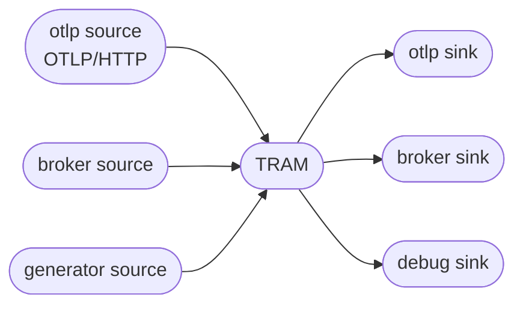

# TRAM: A Lightweight, Extensible Data Pipeline Framework

TRAM is a **cloud-native, in-memory data pipeline framework** for building real-time data processing flows. It enables developers to create, transform, and route data through **tree-structured pipelines** where each tree contains a source, optional stages, and sinks as leaves.

---

## ✨ Features

- **Tree-Based Pipelines**: Define complex data flows with a single source, optional stages, and multiple sinks as leaves
- **Cloud-Native**: Configure streams through the HTTP/gRPC API, JSON files, or Kubernetes custom resources; everything runs in memory
- **Extensible Architecture**: Easily add custom sources, stages, and sinks
- **Real-time Processing**: Event-driven architecture for low-latency data flows
- **OTLP-Native**: Logs, metrics and traces flow through pipelines as OpenTelemetry Protocol (OTLP) data


---

## 🚀 Quick Start

### Installation

```bash
git clone https://github.com/GO-TRAM/TRAM.git tram
cd tram
go build -o tram ./cmd/tram
```

Or build a container image with Docker or Podman: `task image:build` (with [Task](https://taskfile.dev)) or `docker build -t tram:dev .`. Run `task` to see all development tasks, e.g. for tests and benchmarks; [CONTRIBUTING.md](CONTRIBUTING.md#tasks) explains them.

### Run

```bash
./tram server
```

The container image starts the server with both APIs listening on all interfaces of the container: `docker run --rm -p 8080:8080 -p 50051:50051 tram:dev`.

By default the HTTP API listens on `localhost:8080` and the gRPC API on `localhost:50051`. `--log-level` sets the log level (`debug`, `info`, `warn` or `error`; default `info`). See `./tram server --help` for all flags.

### Create a First Stream

Create a stream whose `generator` source emits an event every 5 seconds and whose `debug` sink logs it to stdout:

```bash
curl -X PUT http://localhost:8080/v1/streams/my-pipeline \
  -H "Content-Type: application/json" \
  -d '{
    "stream": {
      "name": "my-pipeline",
      "source": {
        "name": "event-generator",
        "type": "generator",
        "spec": {
          "interval": "5s"
        }
      },
      "sinks": [
        {
          "name": "console",
          "type": "debug",
          "from": "event-generator"
        }
      ]
    }
  }'
```

More examples are under [Example API Usage](#example-api-usage).

## 🌐 API Endpoints

The TRAM service provides the following HTTP endpoints:

| Method | Endpoint | Description |
|--------|----------|-------------|
| GET | `/v1/streams` | List all streams, ordered by name |
| PUT | `/v1/streams/{name}` | Create or update a stream |
| GET | `/v1/streams/{name}` | Get a stream configuration |
| DELETE | `/v1/streams/{name}` | Delete a stream |
| GET | `/metrics` | Metrics of TRAM in the Prometheus format, see [Metrics](#metrics) |

The stream name is taken from the URL; a `name` in the request body is replaced by it.

## 📡 Example API Usage

### Create a Pipeline with Stages

This example adds a `noop` stage between the source and sinks:

```bash
curl -X PUT http://localhost:8080/v1/streams/processing-pipeline \
  -H "Content-Type: application/json" \
  -d '{
    "stream": {
      "name": "processing-pipeline",
      "source": {
        "name": "events-source",
        "type": "generator",
        "spec": {
          "interval": "1s"
        }
      },
      "stages": [
        {
          "name": "passthrough",
          "type": "noop",
          "from": "events-source"
        }
      ],
      "sinks": [
        {
          "name": "console",
          "type": "debug",
          "from": "passthrough"
        }
      ]
    }
  }'
```

### Get Stream Configuration

```bash
curl http://localhost:8080/v1/streams/my-pipeline
```

### Delete a Stream

```bash
curl -X DELETE http://localhost:8080/v1/streams/my-pipeline
```

---

## 📊 Metrics

`GET /metrics` on the HTTP API serves TRAM's metrics in the Prometheus format, for Prometheus or any other scraper. By default the source and the sinks of every stream are measured, whatever their type, and the stages are not; see [Choosing the metrics of a stream](#choosing-the-metrics-of-a-stream):

| Metric | Type | Labels | Description |
|--------|------|--------|-------------|
| `tram_node_records_total` | Counter | `stream`, `node`, `kind`, `signal` | Records the node received: log records, metric data points and spans. `kind` is `source`, `stage` or `sink`, `signal` is `logs`, `metrics` or `traces` |
| `tram_node_records_out_total` | Counter | `stream`, `node`, `kind`, `signal` | Records a source or stage passed on: log records, metric data points and spans. With several children, each record counts once, not once per child. Sinks pass nothing on |
| `tram_node_duration_seconds` | Histogram | `stream`, `node`, `kind`, `outcome` | Time the node took to handle an event. `outcome` is `ok`, `rejected` (the event was refused for good, e.g. by a `validation` stage), `cancelled` (the caller gave up, e.g. an OTLP client that closed its connection) or `error`. An expired `delivery_timeout` counts as `error`, since then TRAM took too long |
| `tram_source_request_size_bytes` | Histogram | `stream`, `node`, `kind`, `encoding`, `body` | Size of the requests a source decoded events from, such as the OTLP source. `body` is `received` (as sent, e.g. gzip-compressed) or `decoded` (after undoing the content encoding), `encoding` is `gzip` or `identity`. Sources that consume messages, like the broker source, report nothing |

The endpoint also serves the Go runtime (`go_*`) and process (`process_*`) metrics.

For a source, the records are what it accepted and passed on, each counted once however many branches the stream has, and the outcome is the result its client gets: an event a single branch fails fails for the client. Events a source refuses before passing them on, such as an OTLP request that cannot be decoded, are not counted.

Events pass through a stream synchronously, so the duration of a source or stage includes the stages and sinks below it, and for a `batch` stage the time an event waits for its batch to be flushed. The duration of a source is the time its client waits for TRAM. Only the duration of a sink is its own.

So the time a stream's stages take, including the wait of a `batch` stage, is the duration of its source minus that of its sinks, without measuring the stages themselves.

A stage's input minus its output is what it dropped, so the share each stage drops, for streams that measure the records of their stages, is:

```promql
1 - sum by (stream, node) (rate(tram_node_records_out_total{kind="stage"}[5m]))
  / sum by (stream, node) (rate(tram_node_records_total{kind="stage"}[5m]))
```

The average size of the requests a source received, compressed as sent and decoded, and the share of requests above 1 MB, half of a common 2 MB ingress limit:

```promql
sum by (stream, body) (rate(tram_source_request_size_bytes_sum[5m]))
  / sum by (stream, body) (rate(tram_source_request_size_bytes_count[5m]))

1 - sum by (stream) (rate(tram_source_request_size_bytes_bucket{body="received",le="1.048576e+06"}[5m]))
  / sum by (stream) (rate(tram_source_request_size_bytes_count{body="received"}[5m]))
```

A stage that drops every record of a signal, such as a `filter` whose CEL expression for it is `"false"`, has no output series for that signal, so drop the `signal` label or use `or vector(0)` when comparing per signal.

### Choosing the metrics of a stream

Every node is a series of its own per metric, so many streams with several stages each add up to many series. The optional `metrics` field of a stream turns each metric on or off per kind of node; fields left out keep their defaults:

| Field | Metrics | Defaults |
|-------|---------|----------|
| `records` | `tram_node_records_total` and `tram_node_records_out_total` | `source: true`, `stages: false`, `sinks: true` |
| `duration` | `tram_node_duration_seconds` | `source: true`, `stages: false`, `sinks: true` |
| `request_size` | `tram_source_request_size_bytes` | `true` |

To see what each stage of a stream drops and how long it takes:

```json
"metrics": {
  "records": {"stages": true},
  "duration": {"stages": true}
}
```

The field is part of the stream in the API, in the files of the file sync and in the `Stream` resource of the Kubernetes operator (`spec.metrics`). Changing it rewires the stream's stages and sinks but keeps its source running. Series of a node that stops being measured stay at their last value until TRAM restarts.

---

## 🏗️ Core Concepts

### Pipeline Structure

Streams follow a **tree structure** with these rules:

1. Each pipeline has **exactly one source** (root)
2. **Stages** can be connected to the source or other stages
3. **Sinks** must be connected to either the source or a stage
4. **All leaves must be sinks** (no dangling stages)


### Data Flow

```
Source → [Stage] → Sink
```

*Arrows represent the direction of data flow, from source to sinks.*

---

## 📋 Available Components

| Type | Components |
|------|-------------|
| **Sources** | `broker`, `generator`, `otlp` |
| **Stages** | `batch`, `delay`, `filter`, `noop`, `validation`, `value_map` |
| **Sinks** | `broker`, `debug`, `otlp` |

For detailed documentation on each component and its configuration, see [COMPONENTS.md](COMPONENTS.md).


---

## 🔧 Advanced Configuration

### Fan-out Pattern

Route data from a single source to multiple sinks. Every sink receives every event:

```bash
curl -X PUT http://localhost:8080/v1/streams/fanout-example \
  -H "Content-Type: application/json" \
  --data-binary @- <<'EOF'
{
  "stream": {
    "name": "fanout-example",
    "source": {
      "name": "otlp-in",
      "type": "otlp",
      "spec": { "http_port": 4318 }
    },
    "sinks": [
      {
        "name": "console",
        "type": "debug",
        "from": "otlp-in"
      },
      {
        "name": "archive",
        "type": "broker",
        "from": "otlp-in",
        "spec": {
          "driver": "nats",
          "nats": { "url": "nats://localhost:4222" },
          "destination": {
            "logs": "'logs.' + logs.resource_logs[0].resource.attributes.get_attr('service.name')"
          }
        }
      }
    ]
  }
}
EOF
```

The `broker` sink with `driver: nats` needs a NATS server with JetStream enabled, e.g. `docker compose -f examples/nats/docker-compose.yaml up -d`, and a stream for its subjects, which TRAM does not create: `nats stream add telemetry --subjects 'logs.>' --defaults`.

### Chained Stages

Process data through multiple stages before reaching sinks:

```bash
curl -X PUT http://localhost:8080/v1/streams/chained-pipeline \
  -H "Content-Type: application/json" \
  -d '{
    "stream": {
      "name": "chained-pipeline",
      "source": {
        "name": "source",
        "type": "generator",
        "spec": { "interval": "1s" }
      },
      "stages": [
        {
          "name": "stage1",
          "type": "noop",
          "from": "source"
        },
        {
          "name": "stage2",
          "type": "noop",
          "from": "stage1"
        }
      ],
      "sinks": [
        {
          "name": "output",
          "type": "debug",
          "from": "stage2"
        }
      ]
    }
  }'
```

### Example Setup

Two streams read a NATS topic and forward the data, one to an OTLP endpoint and one to the debug log; a third stream receives OTLP data and publishes it to NATS:


---

## 🔄 Updating a Stream

A `PUT` to an existing stream changes as little as possible:

| Change | Effect |
|--------|--------|
| None | Nothing happens; the running stream is kept |
| Stages, sinks or `metrics` only | The new stages and sinks are created, events still in flight finish in the old ones, and the source switches over. The source keeps running, e.g. an OTLP source keeps its port open, and no event is lost |
| Source | The stream is stopped and created again. An OTLP source closes its port in between, so clients briefly cannot connect |

If an update fails, e.g. because of an invalid component spec, the request returns an error and the previous version of the stream keeps running. Delete and create a stream to restart it completely.

### Dry Run

`PUT /v1/streams/{name}` with `"dry_run": true` in the request body validates the stream and reports what applying it would do, without changing the running stream. The flag is a field of the request body, not a query parameter, because the PUT body maps to the whole request message. The response holds a `plan`:

```json
{
  "stream": { "...": "the requested stream" },
  "plan": {
    "action": "STREAM_PLAN_ACTION_HOT_SWAP",
    "sourceReplaced": false,
    "createdNodes": ["enrich"],
    "stoppedNodes": ["old-sink"]
  }
}
```

`action` is `STREAM_PLAN_ACTION_NOOP` (nothing would change), `STREAM_PLAN_ACTION_HOT_SWAP` (the source keeps running and its stages and sinks are replaced below it) or `STREAM_PLAN_ACTION_REBUILD` (the stream is new, stopped, or its source changed: it would be stopped and created again). An invalid spec is rejected with `400` as usual; nothing is applied either way.

If the source of a stream stops on its own, e.g. because the NATS stream of a broker source does not exist yet, TRAM restarts the stream after a delay that grows from 1 second to 1 minute while it keeps failing. A `PUT` of the unchanged stream restarts it right away.

---

## Testing a Stream

A stream can carry test cases in `tests`. They are never run by loading the stream; only an explicit test run executes them:

```bash
tram test stream.json [--secrets secrets.json]
```

The file holds either a bare stream object or a file sync file that wraps it in `{"stream": {...}}`, like the examples in `examples/tests/`; see `examples/tests/otlp_with_filters.json` for a stream with test cases.

The stream is loaded into its own in-memory tree: the source is replaced by a test source that emits the test inputs, and every sink by a capture sink, so no external system is contacted. The stages are the real stages and process the events.

Each test has a `name`, an `input` event and the expected outcome per sink in `expect`:

- `"out": <event>` — sink `out` must receive exactly this event. Events are OTLP JSON objects with one of the keys `logs`, `metrics` or `traces`
- `"out": "drop"` — sink `out` must receive nothing
- `"out": "reject"` — the event must be rejected by a stage
- a sink without an entry in `expect` must receive nothing

```json
"tests": [
  {
    "name": "keeps real logs",
    "input":  {"logs": {"resourceLogs": [{"scopeLogs": [{"logRecords": [{"body": {"stringValue": "hello"}}]}]}]}},
    "expect": {"out": {"logs": {"resourceLogs": [{"scopeLogs": [{"logRecords": [{"body": {"stringValue": "hello"}}]}]}]}}}
  },
  {
    "name": "drops noise",
    "input":  {"logs": {"resourceLogs": [{"scopeLogs": [{"logRecords": [{"body": {"stringValue": "noise"}}]}]}]}},
    "expect": {"out": "drop"}
  }
]
```

`--secrets` reads a JSON file mapping `"<name>/<key>"` to values and resolves `secretKeyRef` references in stage specs. A reference that cannot be resolved is an error naming the reference, never its value. Source and sink specs are not used by a test run. The exit code is 0 when all tests pass and 1 otherwise.

---

## ⚙️ Configuration Sources

Besides the API, streams can be managed from two further sources. All of them change the same set of streams.

### File Sync

```bash
./tram server --enable-file-sync --config-dir config
```

Every `<name>.json` file in the directory describes one stream, in the same format as the API request body (`{"stream": {...}}`); see `examples/config/` for examples. The file name, without `.json`, is the stream name. The sync works in both directions:

- Adding, changing or deleting a file creates, updates or deletes the stream
- Streams created or changed through the API or the Kubernetes operator are written to files (new files are readable only by the owner, mode `0600`), and deleted streams have their file removed
- Streams without a file are deleted when the directory is synced
- A stream that cannot be created or updated, e.g. because NATS is not reachable yet when TRAM starts, is tried again without its file changing: after 1 second, then with a delay that doubles up to 30 seconds, until every stream is applied. Changing a file starts over with the shortest delay. A stream that keeps failing is logged once a minute; one that is applied after failing is logged once more. A file that is invalid for good is tried again as well, so fix or remove it

### Kubernetes Operator

```bash
kubectl apply -f manifests/crds/io.tram.core_streams.yaml
./tram server --enable-k8s-operator
```

The operator watches `Stream` resources (`io.tram.core/v1`) and runs each as a stream named `<namespace>.<name>`. It uses the in-cluster configuration or the current kubeconfig context; `--kubeconfig` selects another file. By default every TRAM instance runs every `Stream` resource in the cluster, including those that name engines. With `--watch-namespace` limits an instance to some namespaces, and `--engine` to the `Stream` resources of one Engine. See [the operator documentation](internal/adapters/k8scrd/README.md) for details.

Alternatively, `tram manager` runs `Engine` resources (`io.tram.core/v1alpha1`) as Deployments of TRAM instances, and a `Stream` names the engines that run it in `spec.engineRefs`; see [Engines](internal/adapters/k8scrd/README.md#engines) and `examples/k8s/`. The Helm chart [`charts/tram`](charts/tram/), or the kustomization in [`manifests/`](manifests/), installs the manager with the CRDs:

```bash
helm install tram oci://ghcr.io/go-tram/charts/tram --version 0.0.20 --namespace tram-system --create-namespace
# or
kubectl apply --server-side -f https://github.com/GO-TRAM/TRAM/releases/download/v0.0.20/tram.yaml
```

Every release publishes the chart and the manifests with its version; from the repository, `charts/tram` and `kubectl apply --server-side -k manifests/` deploy the image `latest`.

---

## 🔒 Security

TRAM has no authentication or authorization of its own. Whoever can create a stream decides which ports TRAM opens and where it sends data, so treat access to every configuration source like access to the TRAM process:

- **API**: the gRPC and HTTP APIs accept every request. They listen on `localhost` by default; if you bind them to other interfaces with `--grpc-endpoint` and `--http-endpoint`, restrict access, e.g. with a network policy or an authenticating proxy in front
- **Profiling**: `--pprof-endpoint` serves the Go profiles under `/debug/pprof/` on their own endpoint, without authentication; it is off by default. Profiles reveal internals such as stack traces and command-line arguments, so bind it to `localhost` or a port that is not exposed, and reach it with `kubectl port-forward`. It also turns on mutex and block profiling, which costs a little on contended locks
- **OTLP source**: listens on the configured port on all network interfaces, without TLS or authentication. Anyone who can reach the port can send data into the stream. Restrict it on the network level, or terminate TLS and authenticate in a proxy in front of it
- **Sinks**: an OTLP sink sends data to any URL in its spec, and `insecure: true` turns off certificate checks. Keep credentials in sink specs, e.g. in `headers` or NATS URLs, out of version control; the file sync writes new files readable only by their owner
- **Kubernetes operator**: watches `Stream` resources in all namespaces unless `--watch-namespace` is set, so everyone allowed to create a `Stream` in a watched namespace can open ports on the TRAM pod and send data anywhere TRAM can reach. A `Stream` can also refer to secrets and config maps in its namespace, which TRAM reads and passes to the stream, so its author can send their values anywhere. Grant `create` on `streams.io.tram.core` only to users you would also trust with the TRAM deployment and with the secrets and config maps of that namespace. `spec.engineRefs` is no access control either: anyone who can create a `Stream` in an Engine's namespace can run it on that Engine

---

## 📖 Documentation

- **Components**: See [COMPONENTS.md](COMPONENTS.md) for detailed component documentation
- **Kubernetes Operator**: See [the operator documentation](internal/adapters/k8scrd/README.md)
- **Performance and Sizing**: See [BENCHMARK.md](BENCHMARK.md) for pipeline benchmarks and sizing guidance
- **Development**: See [CONTRIBUTING.md](CONTRIBUTING.md) for development and contribution guidelines

---

## 📜 License

TRAM is licensed under the **Mozilla Public License 2.0** - see the [LICENSE](LICENSE) file for details.
