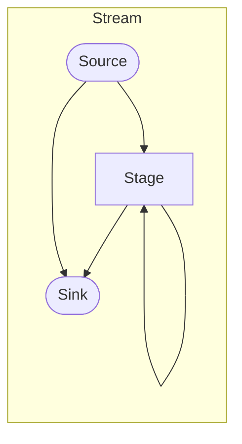
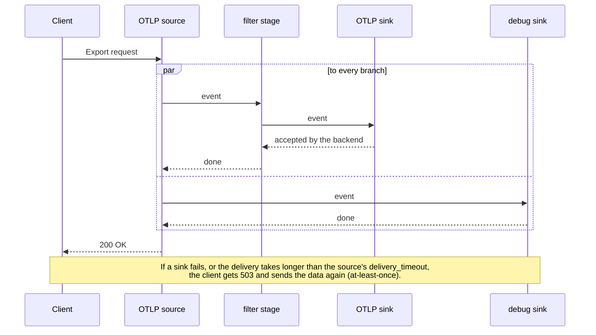
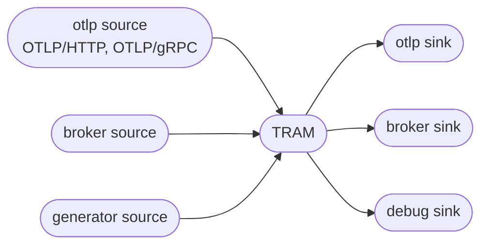
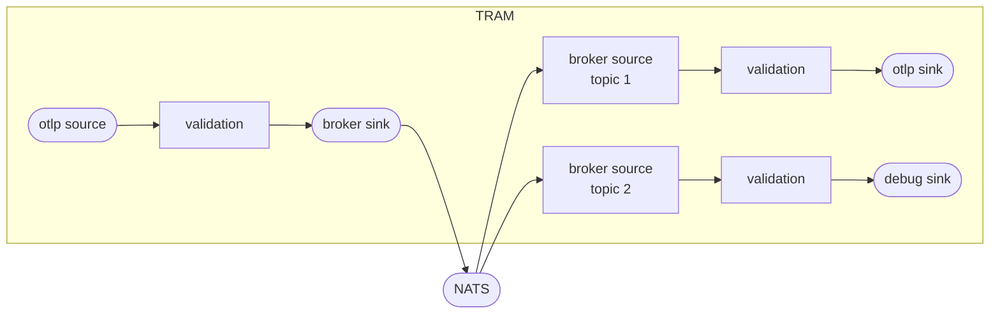
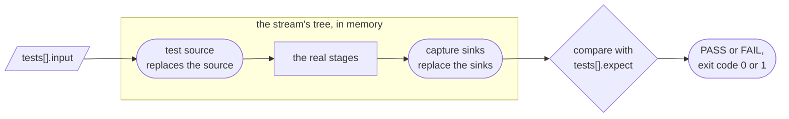
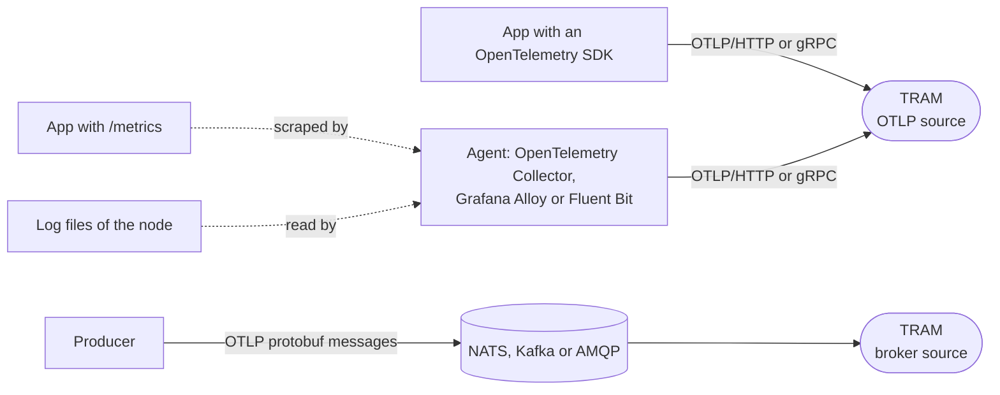
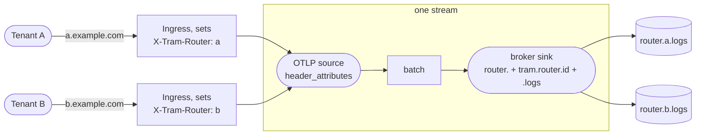

[](https://artifacthub.io/packages/search?repo=tram)
[](https://github.com/go-tram/tram/actions/workflows/release.yml)
[](https://github.com/go-tram/tram/actions/workflows/ci.yml)


# TRAM: A Lightweight, Extensible Data Pipeline Framework

TRAM is a **cloud-native, in-memory data pipeline framework** for building real-time data processing flows. It enables developers to create, transform, and route data through **tree-structured pipelines** where each tree contains a source, optional stages, and sinks as leaves.

---

## ✨ Features

- **Tree-Based Pipelines**: Define complex data flows with a single source, optional stages, and multiple sinks as leaves
- **Cloud-Native**: Configure streams through the HTTP/gRPC API, JSON files, or Kubernetes custom resources; everything runs in memory
- **Extensible Architecture**: Easily add custom sources, stages, and sinks
- **Real-time Processing**: Event-driven architecture for low-latency data flows
- **OTLP-Native**: Logs, metrics and traces flow through pipelines as OpenTelemetry Protocol (OTLP) data


---

## 🚀 Quick Start

### Installation

```bash
git clone https://github.com/go-tram/tram.git tram
cd tram
go build -o tram ./cmd/tram
```

Or build a container image with Docker or Podman: `task image:build` (with [Task](https://taskfile.dev)) or `docker build -t tram:dev .`. Run `task` to see all development tasks, e.g. for tests and benchmarks; [CONTRIBUTING.md](CONTRIBUTING.md#tasks) explains them.

### Run

```bash
./tram server
```

The container image starts the server with both APIs listening on all interfaces of the container: `docker run --rm -p 8080:8080 -p 50051:50051 tram:dev`.

By default the HTTP API listens on `localhost:8080`, the gRPC API on `localhost:50051` and the [admin API](#admin-api) on `localhost:50052`. `--log-level` sets the log level (`debug`, `info`, `warn` or `error`; default `info`). See `./tram server --help` for all flags.

### Create a First Stream

Create a stream whose `generator` source emits an event every 5 seconds and whose `debug` sink logs it to stdout:

```bash
curl -X PUT http://localhost:8080/v1/streams/my-pipeline \
  -H "Content-Type: application/json" \
  -d '{
    "stream": {
      "name": "my-pipeline",
      "source": {
        "name": "event-generator",
        "type": "generator",
        "spec": {
          "interval": "5s"
        }
      },
      "sinks": [
        {
          "name": "console",
          "type": "debug",
          "from": "event-generator"
        }
      ]
    }
  }'
```

More examples are under [Example API Usage](#example-api-usage).

## 🌐 API Endpoints

The TRAM service provides the following HTTP endpoints:

| Method | Endpoint | Description |
|--------|----------|-------------|
| GET | `/v1/streams` | List all streams, ordered by name |
| PUT | `/v1/streams/{name}` | Create or update a stream |
| GET | `/v1/streams/{name}` | Get a stream configuration |
| DELETE | `/v1/streams/{name}` | Delete a stream |
| GET | `/metrics` | Metrics of TRAM in the Prometheus format, see [Metrics](#metrics) |

The stream name is taken from the URL; a `name` in the request body is replaced by it.

### Admin API

The admin API is the API of the `tram` CLI: everything the stream API serves, without `/metrics`, and what looks into the running TRAM, like taps. It hands out the data of the streams, so it has an endpoint of its own, `--admin-endpoint` (default `localhost:50052`; empty disables it), which serves gRPC and HTTP on the same port. On `localhost`, only the host itself or `kubectl port-forward` reaches it, which on Kubernetes needs the `pods/portforward` permission; open it to more on the network level only where everyone who reaches it may read the data. The stream API stays the one for automation, e.g. CI applying streams, and for Prometheus.

| Method | Endpoint | Description |
|--------|----------|-------------|
| | `/v1/streams...` | The endpoints of the stream API above |
| GET | `/v1/streams/{name}/tap` | Stream the events of a running stream, one JSON object per line, see [Tapping a Stream](#tapping-a-stream) |

## 📡 Example API Usage

### Create a Pipeline with Stages

This example adds a `noop` stage between the source and sinks:

```bash
curl -X PUT http://localhost:8080/v1/streams/processing-pipeline \
  -H "Content-Type: application/json" \
  -d '{
    "stream": {
      "name": "processing-pipeline",
      "source": {
        "name": "events-source",
        "type": "generator",
        "spec": {
          "interval": "1s"
        }
      },
      "stages": [
        {
          "name": "passthrough",
          "type": "noop",
          "from": "events-source"
        }
      ],
      "sinks": [
        {
          "name": "console",
          "type": "debug",
          "from": "passthrough"
        }
      ]
    }
  }'
```

### Get Stream Configuration

```bash
curl http://localhost:8080/v1/streams/my-pipeline
```

### Delete a Stream

```bash
curl -X DELETE http://localhost:8080/v1/streams/my-pipeline
```

---

## 📊 Metrics

`GET /metrics` on the HTTP API serves TRAM's metrics in the Prometheus format, for Prometheus or any other scraper. By default the source and the sinks of every stream are measured, whatever their type, and the stages are not; see [Choosing the metrics of a stream](#choosing-the-metrics-of-a-stream):

| Metric | Type | Labels | Description |
|--------|------|--------|-------------|
| `tram_node_records_total` | Counter | `stream`, `node`, `kind`, `signal` | Records the node received: log records, metric data points and spans. `kind` is `source`, `stage` or `sink`, `signal` is `logs`, `metrics` or `traces` |
| `tram_node_records_out_total` | Counter | `stream`, `node`, `kind`, `signal` | Records a source or stage passed on: log records, metric data points and spans. With several children, each record counts once, not once per child. Sinks pass nothing on |
| `tram_node_duration_seconds` | Histogram | `stream`, `node`, `kind`, `outcome` | Time the node took to handle an event. `outcome` is `ok`, `rejected` (the event was refused for good, e.g. by a `validation` stage), `cancelled` (the caller gave up, e.g. an OTLP client that closed its connection) or `error`. An expired `delivery_timeout` counts as `error`, since then TRAM took too long |
| `tram_source_request_size_bytes` | Histogram | `stream`, `node`, `kind`, `encoding`, `body` | Size of the requests a source decoded events from, such as the OTLP source. `body` is `received` (as sent, e.g. gzip-compressed) or `decoded` (after undoing the content encoding), `encoding` is `gzip` or `identity`. Sources that consume messages, like the broker source, report nothing |

The endpoint also serves the Go runtime (`go_*`) and process (`process_*`) metrics.

For a source, the records are what it accepted and passed on, each counted once however many branches the stream has, and the outcome is the result its client gets: an event a single branch fails fails for the client. Events a source refuses before passing them on, such as an OTLP request that cannot be decoded, are not counted.

Events pass through a stream synchronously, so the duration of a source or stage includes the stages and sinks below it, and for a `batch` stage the time an event waits for its batch to be flushed. The duration of a source is the time its client waits for TRAM. Only the duration of a sink is its own.

So the time a stream's stages take, including the wait of a `batch` stage, is the duration of its source minus that of its sinks, without measuring the stages themselves.

A stage's input minus its output is what it dropped, so the share each stage drops, for streams that measure the records of their stages, is:

```promql
1 - sum by (stream, node) (rate(tram_node_records_out_total{kind="stage"}[5m]))
  / sum by (stream, node) (rate(tram_node_records_total{kind="stage"}[5m]))
```

The average size of the requests a source received, compressed as sent and decoded, and the share of requests above 1 MB, half of a common 2 MB ingress limit:

```promql
sum by (stream, body) (rate(tram_source_request_size_bytes_sum[5m]))
  / sum by (stream, body) (rate(tram_source_request_size_bytes_count[5m]))

1 - sum by (stream) (rate(tram_source_request_size_bytes_bucket{body="received",le="1.048576e+06"}[5m]))
  / sum by (stream) (rate(tram_source_request_size_bytes_count{body="received"}[5m]))
```

A stage that drops every record of a signal, such as a `filter` whose CEL expression for it is `"false"`, has no output series for that signal, so drop the `signal` label or use `or vector(0)` when comparing per signal.

### Choosing the metrics of a stream

Every node is a series of its own per metric, so many streams with several stages each add up to many series. The optional `metrics` field of a stream turns each metric on or off per kind of node; fields left out keep their defaults:

| Field | Metrics | Defaults |
|-------|---------|----------|
| `records` | `tram_node_records_total` and `tram_node_records_out_total` | `source: true`, `stages: false`, `sinks: true` |
| `duration` | `tram_node_duration_seconds` | `source: true`, `stages: false`, `sinks: true` |
| `request_size` | `tram_source_request_size_bytes` | `true` |

To see what each stage of a stream drops and how long it takes:

```json
"metrics": {
  "records": {"stages": true},
  "duration": {"stages": true}
}
```

The field is part of the stream in the API, in the files of the file sync and in the `Stream` resource of the Kubernetes operator (`spec.metrics`). Changing it rewires the stream's stages and sinks but keeps its source running. Series of a node that stops being measured stay at their last value until TRAM restarts.

---

## 🏗️ Core Concepts

### Pipeline Structure

Streams follow a **tree structure** with these rules:

1. Each pipeline has **exactly one source** (root)
2. **Stages** can be connected to the source or other stages
3. **Sinks** must be connected to either the source or a stage
4. **All leaves must be sinks** (no dangling stages)



### Data Flow

A stream processes events **in memory and synchronously**. The source hands each event to its stages and sinks and answers only once every sink has accepted it. Nothing is written to disk on the way, so a stream adds no storage and little latency:



Until the source has answered, an event exists only in memory. If the process stops, a client that retries, as OTLP exporters do, sends the events in flight again, since it got no answer. To answer clients before the destination has the data, e.g. to ride out an outage of the destination, write events ahead to disk with **two streams and a buffer between them**; see [Buffers](COMPONENTS.md#buffers).

---

## 📋 Available Components

| Type | Components |
|------|-------------|
| **Sources** | `broker`, `buffer`, `generator`, `otlp` |
| **Stages** | `batch`, `decryption`, `delay`, `encryption`, `filter`, `noop`, `transform`, `validation`, `value_map` |
| **Sinks** | `broker`, `buffer`, `debug`, `otlp` |

For detailed documentation on each component and its configuration, see [COMPONENTS.md](COMPONENTS.md).


---

## 🔧 Advanced Configuration

### Fan-out Pattern

Route data from a single source to multiple sinks. Every sink receives every event:

```bash
curl -X PUT http://localhost:8080/v1/streams/fanout-example \
  -H "Content-Type: application/json" \
  --data-binary @- <<'EOF'
{
  "stream": {
    "name": "fanout-example",
    "source": {
      "name": "otlp-in",
      "type": "otlp",
      "spec": { "http_port": 4318 }
    },
    "sinks": [
      {
        "name": "console",
        "type": "debug",
        "from": "otlp-in"
      },
      {
        "name": "archive",
        "type": "broker",
        "from": "otlp-in",
        "spec": {
          "driver": "nats",
          "nats": { "url": "nats://localhost:4222" },
          "destination": {
            "logs": "'logs.' + logs.resource_logs[0].resource.attributes.get_attr('service.name')"
          }
        }
      }
    ]
  }
}
EOF
```

The `broker` sink with `driver: nats` needs a NATS server with JetStream enabled, e.g. `docker compose -f examples/nats/docker-compose.yaml up -d`, and a stream for its subjects, which TRAM does not create: `nats stream add telemetry --subjects 'logs.>' --defaults`.

### Chained Stages

Process data through multiple stages before reaching sinks:

```bash
curl -X PUT http://localhost:8080/v1/streams/chained-pipeline \
  -H "Content-Type: application/json" \
  -d '{
    "stream": {
      "name": "chained-pipeline",
      "source": {
        "name": "source",
        "type": "generator",
        "spec": { "interval": "1s" }
      },
      "stages": [
        {
          "name": "stage1",
          "type": "noop",
          "from": "source"
        },
        {
          "name": "stage2",
          "type": "noop",
          "from": "stage1"
        }
      ],
      "sinks": [
        {
          "name": "output",
          "type": "debug",
          "from": "stage2"
        }
      ]
    }
  }'
```

### Example Setup

Two streams read a NATS topic and forward the data, one to an OTLP endpoint and one to the debug log; a third stream receives OTLP data and publishes it to NATS:



---

## 🔄 Updating a Stream

A `PUT` to an existing stream changes as little as possible:

| Change | Effect |
|--------|--------|
| None | Nothing happens; the running stream is kept |
| Stages, sinks or `metrics` only | The new stages and sinks are created, events still in flight finish in the old ones, and the source switches over. The source keeps running, e.g. an OTLP source keeps its port open, and no event is lost |
| Source | The stream is stopped and created again. An OTLP source closes its port in between, so clients briefly cannot connect |

If an update fails, e.g. because of an invalid component spec, the request returns an error and the previous version of the stream keeps running. Delete and create a stream to restart it completely.

If the source of a stream stops on its own, e.g. because the NATS stream of a broker source does not exist yet, TRAM restarts the stream after a delay that grows from 1 second to 1 minute while it keeps failing. A `PUT` of the unchanged stream restarts it right away.

Check an update before applying it with a [dry run](#dry-run).

---

## Testing a Stream

There are two ways to check a stream before it runs for real: **test cases** run its stages against sample events, locally or in CI, and a **dry run** asks a running instance what applying a change would do.

### Test Cases

A stream can carry test cases in `tests`. They are never run by loading the stream; only an explicit test run executes them:

```bash
tram test stream.json [--secrets secrets.json]
```

The file holds either a bare stream object or a file sync file that wraps it in `{"stream": {...}}`, like the [examples with test cases](examples/tests/README.md); see [`otlp_with_filters.json`](examples/tests/otlp_with_filters.json) for a stream with test cases.



The stream is loaded into its own in-memory tree: the source is replaced by a test source that emits the test inputs, and every sink by a capture sink, so no external system is contacted. The stages are the real stages and process the events.

Each test has a `name`, an `input` event and the expected outcome per sink in `expect`:

- `"out": <event>` — sink `out` must receive exactly this event. Events are OTLP JSON objects with one of the keys `logs`, `metrics` or `traces`
- `"out": "drop"` — sink `out` must receive nothing
- `"out": "reject"` — the event must be rejected by a stage
- a sink without an entry in `expect` must receive nothing

```json
"tests": [
  {
    "name": "keeps real logs",
    "input":  {"logs": {"resourceLogs": [{"scopeLogs": [{"logRecords": [{"body": {"stringValue": "hello"}}]}]}]}},
    "expect": {"out": {"logs": {"resourceLogs": [{"scopeLogs": [{"logRecords": [{"body": {"stringValue": "hello"}}]}]}]}}}
  },
  {
    "name": "drops noise",
    "input":  {"logs": {"resourceLogs": [{"scopeLogs": [{"logRecords": [{"body": {"stringValue": "noise"}}]}]}]}},
    "expect": {"out": "drop"}
  }
]
```

`--secrets` reads a JSON file mapping `"<name>/<key>"` to values and resolves `secretKeyRef` references in stage specs. A reference that cannot be resolved is an error naming the reference, never its value. Source and sink specs are not used by a test run. The exit code is 0 when all tests pass and 1 otherwise.

### Running Tests in CI

`tram validate streams/` checks all stream files of a directory at once, without a server. `tram test` takes one file and exits with `1` if a test fails, so a CI job runs it for every stream file, e.g. with the [container image](#container-image), whose entry point is `tram`:

```bash
for f in streams/*.json; do
  docker run --rm -v "$PWD:/work" ghcr.io/go-tram/tram:latest test "/work/$f" || exit 1
done
```

Test cases are part of the stream files of the API and file sync. The `Stream` resource of the [Kubernetes operator](internal/adapters/k8scrd/README.md) has no `tests` field, so keep the tests of a stream that runs on Kubernetes in a stream file next to its resource, and test that file.

### Dry Run

`PUT /v1/streams/{name}` with `"dry_run": true` in the request body validates the stream and reports what applying it would do, without changing the running stream. The flag is a field of the request body, not a query parameter, because the PUT body maps to the whole request message. The response holds a `plan`:

```json
{
  "stream": { "...": "the requested stream" },
  "plan": {
    "action": "STREAM_PLAN_ACTION_HOT_SWAP",
    "sourceReplaced": false,
    "createdNodes": ["enrich"],
    "stoppedNodes": ["old-sink"]
  }
}
```

`action` is `STREAM_PLAN_ACTION_NOOP` (nothing would change), `STREAM_PLAN_ACTION_HOT_SWAP` (the source keeps running and its stages and sinks are replaced below it) or `STREAM_PLAN_ACTION_REBUILD` (the stream is new, stopped, or its source changed: it would be stopped and created again). An invalid spec is rejected with `400` as usual; nothing is applied either way.

---

## 💻 The tram CLI

The `tram` binary is the server and its command-line interface. The commands that talk to a server use its [admin API](#admin-api); the others work on local files:

| Command | What it does | Talks to |
|---------|--------------|----------|
| `tram stream list`, `get`, `apply`, `diff`, `delete` | Manage the streams of a server with stream files | admin API |
| `tram tap <stream>` | Show the events passing a running stream, see [Tapping a Stream](#tapping-a-stream) | admin API |
| `tram validate <files>` | Check stream files without running them | – |
| `tram test <file>` | Run the test cases of a stream file, see [Test Cases](#test-cases) | – |
| `tram list` | List the components and their drivers | – |

### Where the CLI Connects

A command that talks to a server finds its target in this order; the CLI has no configuration of its own:

1. `--kube`, `--engine <name>` or `--selector <labels>`: TRAM pods in Kubernetes, see below
2. `--admin-endpoint <host:port>`
3. `TRAM_KUBE=1` (Kubernetes) or `TRAM_ADMIN_ENDPOINT`
4. `localhost:50052`

**Kubernetes**: the CLI reaches the pods itself, as `kubectl port-forward` does, through the kubeconfig: its current context and namespace, or `--kube-context`, `-n` and `--kubeconfig`, as with kubectl. Which pods:

- `--kube`: the pods of the Engines that run the stream. A stream of a `Stream` resource is named `<namespace>.<name>`, so the CLI reads the resource and takes the Engines of its `spec.engineRefs`, in that namespace. A command about no stream, like `tram stream list`, takes the only Engine of the namespace
- `--engine <name>`: the pods of that Engine
- `--selector <labels>`: the pods with those labels, e.g. TRAM pods without an Engine

```bash
tram tap observability.logs --kube        # the Engines of the Stream resource logs
tram stream list --kube -n observability  # the only Engine of the namespace
export TRAM_KUBE=1                        # --kube for every command
```

The CLI takes the admin port of each Engine's spec, and for a selector `--admin-port` (default `50052`). It needs the permissions of a port forward: `get` and `list` on `pods`, `create` on `pods/portforward`, and `get` and `list` on `engines` and `streams`. Every pod runs every stream, so reading commands ask one of them, and `tram tap` taps all of them. Commands that change streams are refused there: the streams of those pods come from `Stream` resources or the file sync, which would undo a change, and a change through the API would reach one pod only.

### Managing Streams

`tram stream` works with stream files, the files of the file sync and `tram test`: a bare stream object or `{"stream": {...}}`. A directory stands for its `*.json` files.

```bash
tram stream list
tram stream get my-stream > my-stream.json     # a stream file that applies unchanged
tram stream diff -f my-stream.json             # a unified diff and what applying would do
tram stream apply -f streams/ --dry-run
tram stream apply -f streams/
tram stream delete my-stream
```

`apply` plans every stream with a [dry run](#dry-run) first: an unchanged stream is left alone, and the output says whether a stream was `created`, `updated, stages and sinks replaced` below its running source, or `rebuilt`.

### Checking Stream Files

`tram validate` checks stream files without running them and without a server: their format, the stream name, that the stream is a tree, and the spec of every component. Every invalid component is reported, and two files with the same stream name are an error. It contacts nothing: a broker component checks its options without connecting, an OTLP source opens no port. Stages are built as in `tram test`, so an `encryption` stage with the `stackit-kms` driver contacts the KMS. References like `secretKeyRef` are resolved from `--secrets`, as in `tram test`.

```bash
tram validate streams/
tram validate my-stream.json --secrets secrets.json
```

```
ok   streams/logs.json (logs)
FAIL streams/metrics.json
  stream spec is invalid: only-errors
  failed to compile CEL expression: ERROR: <input>:1:8: Syntax error: ...
Error: 1 of 2 stream files are invalid
```

`tram list` lists the sources, stages and sinks of the binary with their drivers; [COMPONENTS.md](COMPONENTS.md) documents them.

### Tapping a Stream

`tram tap` shows the events passing a running stream, to see what a source receives, what a stage makes of it, or why a sink fails:

```bash
tram tap my-stream                                # every component
tram tap my-stream --component loki --rate 10     # one component, at most 10 events per second
tram tap my-stream -o json --limit 100 > events.ndjson
tram tap observability.logs --kube                       # every pod that runs it
```

```
10:00:00.120  source otlp  logs 2
    ERROR disk full host=web-1
    INFO  request done host=web-1 status=200
10:00:00.121  stage  only-errors  logs 1
    ERROR disk full host=web-1
10:00:00.135  sink   loki  logs 1  error 14ms: connection refused
    ERROR disk full host=web-1
```

- **What it shows**: a copy of each event at the source and every stage, as they passed it on, and at every sink, as it received it, with whether the sink took it, its error otherwise, and how long it took. `--component` taps one of them
- **It never changes or slows down the stream**: the tap is not part of the stream's spec, so no stream is rebuilt and no configuration source sees a change. Events the tap cannot take in time, or beyond `--rate`, are dropped and reported on stderr (`dropped 12 events`), never held
- **It follows the stream**: the tap keeps running when the stream is updated or restarts, and ends when the stream is deleted or the tapped component is removed
- **It taps every pod**: with several replicas, e.g. of an Engine, every pod runs every stream and gets its share of the data. With `--kube`, `--engine` or `--selector`, `tram tap` taps all pods, shows the pod of every event (`"pod"` in JSON), and follows scaling and rollouts; `--rate` and `--limit` count for all of them together. A tap through `kubectl port-forward deploy/...` sees only the pod the forward picked
- **Where it connects**: the [admin API](#admin-api) of the server over gRPC, see [Where the CLI Connects](#where-the-cli-connects). `-o json` writes one `TapStreamResponse` per line, in the JSON mapping of Protobuf: like OTLP/JSON, but with trace and span IDs in base64 instead of hex

Over HTTP, the admin API streams the same events, one JSON object per line:

```bash
curl -N 'http://localhost:50052/v1/streams/my-stream/tap?component=loki&rate=5'
```

---

## 📥 Sending Data to TRAM

TRAM receives data; it does not collect it. Clients push OTLP over HTTP or gRPC to an [OTLP Source](COMPONENTS.md#otlp-source), or TRAM reads from a broker or a buffer. There is no source that scrapes Prometheus endpoints or tails log files, so whatever cannot send OTLP itself needs an agent that collects its data and sends it on:



| Pattern | How | When |
|---|---|---|
| **SDK** | The application exports OTLP itself, e.g. with `OTEL_EXPORTER_OTLP_ENDPOINT=http://<tram>:4317` over gRPC, the default of most SDKs, or `http://<tram>:4318` with `OTEL_EXPORTER_OTLP_PROTOCOL=http/protobuf` | Instrumented applications; no agent to run |
| **Sidecar** | An agent in the application's pod scrapes or reads it and sends OTLP to TRAM | Per-application settings, or isolation between tenants; costs resources in every pod |
| **Node agent** | An agent per node, e.g. a DaemonSet, reads the logs of all pods on the node and scrapes their metrics | The usual way for logs and scraped metrics on Kubernetes |
| **Gateway** | A central agent scrapes many targets, or receives protocols TRAM does not speak, and forwards to TRAM | Few targets, or protocols other than OTLP |
| **Broker** | Producers publish OTLP protobuf messages to NATS, Kafka or AMQP; a [Broker Source](COMPONENTS.md#broker-source) reads them | Decoupling senders from TRAM, or replaying data |

Agents send **OTLP over gRPC** to the source's `grpc_port`, or **over HTTP**, protobuf or JSON, to its `http_port`; both may be gzip-compressed. With the OpenTelemetry Collector, that is the `otlp` exporter for gRPC or the `otlphttp` exporter for HTTP, e.g. for scraped metrics:

```yaml
receivers:
  prometheus:
    config:
      scrape_configs:
        - job_name: my-app
          static_configs:
            - targets: ["my-app:9090"]
exporters:
  otlp:
    endpoint: tram:4317          # the source's grpc_port
    tls:
      insecure: true             # the OTLP source serves gRPC without TLS
service:
  pipelines:
    metrics:
      receivers: [prometheus]
      exporters: [otlp]
```

TRAM answers `503`, or `Unavailable` over gRPC, when a delivery fails or takes too long, and agents and SDKs retry it; keep their retries and queues enabled, since TRAM's delivery is at-least-once only as far as the sender retries.

### One Ingress per Tenant

When tenants send their own data, a proxy in front of TRAM can name the tenant, so the client cannot choose it: e.g. an ingress per tenant at `<router-id>.example.com` sets the header `X-Tram-Router`, and the OTLP source copies it into a resource attribute with `header_attributes`. Every resource of a request then carries it, and a broker sink routes each record by it, also when a batch stage has merged the requests of several tenants:



The header decides the attribute: a value a client sends in the attribute itself is replaced or removed. See [the OTLP Source](COMPONENTS.md#otlp-source) for the rules, and `examples/config/otlp_tenant_routing.json` for a stream that validates the router ID before the batch. Let only the proxy reach the source's port, and authenticate tenants there.

## 🐳 Container Image

Every release publishes a multi-architecture image (`linux/amd64`, `linux/arm64`) as `ghcr.io/go-tram/tram:<version>`, e.g. `0.0.19`, and as `latest`. It is signed with cosign and carries an SBOM; see [Verifying Releases](SECURITY.md#verifying-releases). It holds only the `tram` binary on a distroless base, runs as the non-root user `65532` and starts `tram server` with both APIs listening on all interfaces of the container:

```bash
docker run --rm -p 8080:8080 -p 50051:50051 -p 4317:4317 -p 4318:4318 ghcr.io/go-tram/tram:latest
```

Publish the ports the sources of your streams listen on as well, e.g. `4317` and `4318` for an OTLP source with gRPC and HTTP. Arguments replace the default command, so repeat the endpoints when adding flags, e.g. for file sync and buffers:

```bash
docker run --rm -p 8080:8080 -p 4318:4318 \
  -v "$PWD/config:/config" -v tram-data:/data \
  ghcr.io/go-tram/tram:latest \
  server --http-endpoint=0.0.0.0:8080 --grpc-endpoint=0.0.0.0:50051 \
  --enable-file-sync --config-dir /config --data-dir /data
```

The directories have to be writable by the user `65532`. The image has no shell; debug from another container in the same network.

## ⚙️ Configuration Sources

Besides the API, streams can be managed from files and, on Kubernetes, from `Stream` resources through the [operator](internal/adapters/k8scrd/README.md). All of them change the same set of streams.

### File Sync

```bash
./tram server --enable-file-sync --config-dir config
```

Every `<name>.json` file in the directory describes one stream, in the same format as the API request body (`{"stream": {...}}`); see `examples/config/` for examples. The file name, without `.json`, is the stream name. The sync works in both directions:

- Adding, changing or deleting a file creates, updates or deletes the stream
- Streams created or changed through the API or the Kubernetes operator are written to files (new files are readable only by the owner, mode `0600`), and deleted streams have their file removed
- Streams without a file are deleted when the directory is synced
- A stream that cannot be created or updated, e.g. because NATS is not reachable yet when TRAM starts, is tried again without its file changing: after 1 second, then with a delay that doubles up to 30 seconds, until every stream is applied. Changing a file starts over with the shortest delay. A stream that keeps failing is logged once a minute; one that is applied after failing is logged once more. A file that is invalid for good is tried again as well, so fix or remove it

### Kubernetes Operator

```bash
kubectl apply -f manifests/crds/io.tram.core_streams.yaml
./tram server --enable-k8s-operator
```

The operator watches `Stream` resources (`io.tram.core/v1`) and runs each as a stream named `<namespace>.<name>`. It uses the in-cluster configuration or the current kubeconfig context; `--kubeconfig` selects another file. By default every TRAM instance runs every `Stream` resource in the cluster, including those that name engines. With `--watch-namespace` limits an instance to some namespaces, and `--engine` to the `Stream` resources of one Engine. See [the operator documentation](internal/adapters/k8scrd/README.md) for details.

Alternatively, `tram manager` runs `Engine` resources (`io.tram.core/v1alpha1`) as Deployments of TRAM instances, and a `Stream` names the engines that run it in `spec.engineRefs`; see [Engines](internal/adapters/k8scrd/README.md#engines) and `examples/k8s/`. The Helm chart [`charts/tram`](charts/tram/), or the kustomization in [`manifests/`](manifests/), installs the manager with the CRDs:

```bash
helm install tram oci://ghcr.io/go-tram/charts/tram --namespace tram-system --create-namespace
# or
kubectl apply --server-side -f https://github.com/go-tram/tram/releases/latest/download/tram.yaml
```

Without `--version`, Helm installs the latest chart; every release publishes the chart and the manifests with its version, e.g. `--version 0.0.19` or `releases/download/v0.0.19/tram.yaml`. From the repository, `charts/tram` and `kubectl apply --server-side -k manifests/` deploy the image `latest`.

---

### Conflicts Between Configuration Sources

TRAM holds one set of streams. The API, the file sync and the operator all write to it, and a stream does not belong to any of them: whatever changed a stream last decides what runs, until a source writes it again. When each source writes decides how a change from another source lasts:

| Source | Writes a stream | Removes a stream |
|--------|-----------------|------------------|
| API | On every request | On a `DELETE` request |
| File sync | When a file in the directory changes, for every file that differs from its running stream; while streams fail, again after each retry delay | Every running stream without a file, when the directory is synced, whichever source created it |
| Operator | When the `Stream` resource's `spec`, a secret it refers to or a config map it selects changes, and when the instance starts | When the resource is deleted |

The file sync writes changes of the API and the operator back to the files, so a stream changed elsewhere keeps its file. The operator does not write back to resources, and its periodic resyncs do not apply the resource again. That means:

- **API change to a stream of a `Stream` resource:** runs until the resource changes or the instance restarts; then the resource wins again. With file sync, the change is also written to the stream's file
- **Changed file of a stream of a `Stream` resource:** the file wins in the same way, until the resource changes or the instance restarts
- **Deleted file, or API `DELETE`, of a stream of a `Stream` resource:** the stream stops, and the operator starts it again only when the resource changes or the instance restarts
- **API change to a stream with a file:** written to the file, so it survives a restart. A change to the file afterwards wins over it
- **Changes of the same stream at the same moment:** applied one after the other, in no defined order; the last one wins

Give every stream one source that owns it and change it only there:

- With the operator, change streams only through `Stream` resources, and use the API and the files to read them
- Use file sync together with the operator only to keep a copy of the streams on disk, and do not edit the files of streams that come from resources
- The operator names its streams `<namespace>.<name>`; do not create streams with such a name through the API or a file, or the operator replaces them

## 🔒 Security

TRAM has no authentication or authorization of its own. Whoever can create a stream decides which ports TRAM opens and where it sends data, so treat access to every configuration source like access to the TRAM process:

- **API**: the gRPC and HTTP APIs accept every request. They listen on `localhost` by default; if you bind them to other interfaces with `--grpc-endpoint` and `--http-endpoint`, restrict access, e.g. with a network policy or an authenticating proxy in front
- **Admin API**: hands out the events of every stream to whoever taps them, see [Admin API](#admin-api). It listens on `localhost:50052` by default, so on Kubernetes only those allowed to port-forward to the pod reach it. Do not bind it to other interfaces where people reach it who must not read the data; `--admin-endpoint=""` turns it off
- **Profiling**: `--pprof-endpoint` serves the Go profiles under `/debug/pprof/` on their own endpoint, without authentication; it is off by default. Profiles reveal internals such as stack traces and command-line arguments, so bind it to `localhost` or a port that is not exposed, and reach it with `kubectl port-forward`. It also turns on mutex and block profiling, which costs a little on contended locks
- **OTLP source**: listens on the configured port on all network interfaces, without TLS or authentication. Anyone who can reach the port can send data into the stream. Restrict it on the network level, or terminate TLS and authenticate in a proxy in front of it
- **Sinks**: an OTLP sink sends data to any URL in its spec, and `insecure: true` turns off certificate checks. Keep credentials in sink specs, e.g. in `headers` or NATS URLs, out of version control; the file sync writes new files readable only by their owner
- **Kubernetes operator**: watches `Stream` resources in all namespaces unless `--watch-namespace` is set, so everyone allowed to create a `Stream` in a watched namespace can open ports on the TRAM pod and send data anywhere TRAM can reach. A `Stream` can also refer to secrets and config maps in its namespace, which TRAM reads and passes to the stream, so its author can send their values anywhere. Grant `create` on `streams.io.tram.core` only to users you would also trust with the TRAM deployment and with the secrets and config maps of that namespace. `spec.engineRefs` is no access control either: anyone who can create a `Stream` in an Engine's namespace can run it on that Engine

---

## 📖 Documentation

- **Components**: See [COMPONENTS.md](COMPONENTS.md) for detailed component documentation
- **Kubernetes Operator**: See [the operator documentation](internal/adapters/k8scrd/README.md)
- **Performance and Sizing**: See [BENCHMARK.md](BENCHMARK.md) for pipeline benchmarks and sizing guidance
- **Development**: See [CONTRIBUTING.md](CONTRIBUTING.md) for development and contribution guidelines

---

## 📜 License

TRAM is licensed under the **Mozilla Public License 2.0** - see the [LICENSE](LICENSE) file for details.
