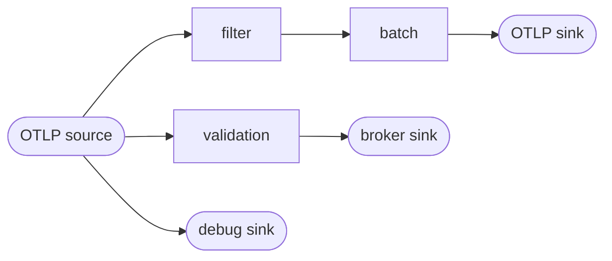

---
hide:
  - navigation
  - toc
---

<div class="tram-hero" markdown>

<h1 class="tram-hero__logo"></h1>

<div markdown>

<p class="tram-hero__tagline">A lightweight, extensible pipeline framework for logs, metrics and traces.</p>

[Get Started](guide/getting-started.md){ .md-button .md-button--primary }
[Components](components/index.md){ .md-button }
[Source Code](https://github.com/go-tram/tram){ .md-button }

</div>

</div>

TRAM is a **cloud-native, in-memory data pipeline framework** for building real-time data processing flows. It receives OpenTelemetry data, filters, validates and batches it, and routes it through **tree-structured pipelines** to any number of destinations.



## Features

<div class="grid cards" markdown>

- :material-file-tree:{ .lg .middle } **Tree-Based Pipelines**

    ---

    Define data flows with a single source, optional stages and any number of sinks as leaves.

- :material-cloud-outline:{ .lg .middle } **Cloud-Native**

    ---

    Configure streams through the HTTP/gRPC API, JSON files or Kubernetes custom resources. Everything runs in memory.

- :material-puzzle-outline:{ .lg .middle } **Extensible**

    ---

    Easily add custom sources, stages and sinks.

- :material-lightning-bolt-outline:{ .lg .middle } **Real-Time**

    ---

    An event-driven architecture for low-latency data flows.

- :simple-opentelemetry:{ .lg .middle } **OTLP-Native**

    ---

    Logs, metrics and traces flow through the pipelines as OpenTelemetry Protocol data.

- :material-chart-line:{ .lg .middle } **Observable**

    ---

    Records, durations and request sizes of every node are served as Prometheus metrics.

</div>

## Quick Start

```bash
git clone https://github.com/go-tram/tram.git tram
cd tram
go build -o tram ./cmd/tram
./tram server
```

The HTTP API then listens on `localhost:8080`. Create a first stream that logs a generated event every 5 seconds:

```bash
curl -X PUT http://localhost:8080/v1/streams/my-pipeline \
  -H "Content-Type: application/json" \
  -d '{
    "stream": {
      "source": { "name": "event-generator", "type": "generator", "spec": { "interval": "5s" } },
      "sinks": [ { "name": "console", "type": "debug", "from": "event-generator" } ]
    }
  }'
```

## Learn More

<div class="grid cards" markdown>

- :material-rocket-launch-outline: **[Getting Started](guide/getting-started.md)**

    Install TRAM, run it and create your first streams

- :material-sitemap-outline: **[Streams](guide/streams.md)**

    How sources, stages and sinks form a stream, and how to update one while it runs

- :material-puzzle: **[Components](components/index.md)**

    Every source, stage and sink with its configuration

- :material-kubernetes: **[Kubernetes Operator](deployment/kubernetes/index.md)**

    Run streams described by `Stream` custom resources

- :material-speedometer: **[Benchmarks](operations/benchmarks.md)**

    What pipelines cost, and how to size deployments

- :material-transit-connection-variant: **[Sending Data to TRAM](guide/sending-data.md)**

    From SDKs, agents and brokers, and what to do without OTLP

</div>
